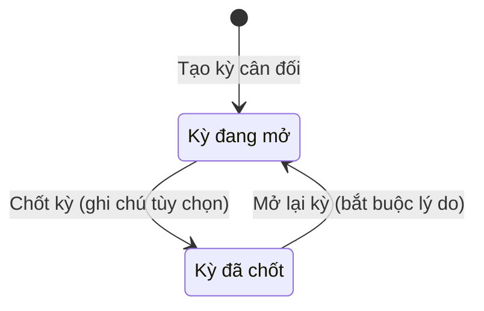
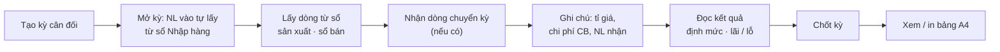
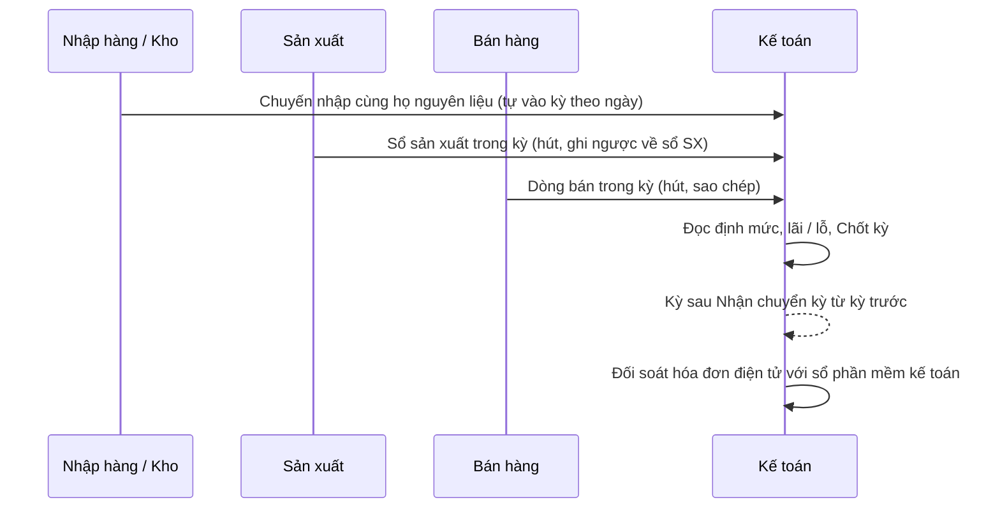

# Báo cáo & Cân đối — sơ đồ workflow

> Load khi: review / kiểm lại các trang Cân đối kỳ (`/balancing`), Báo cáo thành phẩm (`/production-report`), Báo cáo đơn xuất (`/export-report`), Tồn kho thành phẩm (`/nxt`), Đối soát hóa đơn điện tử (`/reconciliation`); trước khi sửa công thức định mức, lãi / lỗ, chốt kỳ, tồn thành phẩm. Bản đọc nhanh — luật đầy đủ ở [31-can-doi-ky](../app-map/31-can-doi-ky.md) · [37-doi-soat-hddt](../app-map/37-doi-soat-hddt.md) · ba-spec [34](../app-map/34-btp-san-xuat-kho.ba-spec.md) · [53](../app-map/53-filters.ba-spec.md).
covers: src/features/balancing/*, src/features/reports/*, src/features/reconciliation/*, src/lib/balancingCalc.ts, src/lib/balancingGrid.ts, src/lib/balancingStockLines.ts, src/lib/inventoryFinished.ts, src/lib/einvoiceReconciliation.ts, src/lib/twoVersionReconciliation.ts, src/lib/reconciliation*.ts
tours: src/features/balancing/balancingTour.ts, src/features/reports/productionReportTour.ts, src/features/reports/exportReportTour.ts, src/features/reports/finishedGoodStockTour.ts, src/features/reconciliation/reconciliationTour.ts
guides: src/features/shared/guideContent.tsx, src/features/shared/guides/reconciliationGuide.tsx
last_verified: 2026-11-03
ttl_days: 90

Sửa code trong `covers:` mà không sửa file này ⇒ commit bị chặn ([README](README.md) § Luật đồng bộ).

Cân đối trả lời một câu: lô nguyên liệu này ra bao nhiêu bán thành phẩm, định mức bao nhiêu, lãi hay lỗ. Các trang báo cáo còn lại chỉ đọc số từ sổ gốc.

## 1. Một kỳ cân đối đi qua những trạng thái nào

| Trạng thái | Nghĩa | Sang bước sau khi | Ai làm | Code |
|---|---|---|---|---|
| Kỳ đang mở | Còn gõ và hút số được. Sổ Nhập hàng, sổ Sản xuất sửa thì kỳ tính lại | Đã đối chiếu xong, gửi kế toán: bấm **Chốt kỳ** | Người có quyền Chốt (`lock`) | `PeriodLockDialog` |
| Kỳ đã chốt | Mọi ô trong lưới khóa. Dòng phụ ghi "Khoá lúc …" và ghi chú. Sổ gốc sửa sau thì màn vẫn tính theo sổ, nhưng số đã lưu của kỳ không đổi | Bấm **Mở lại kỳ**, bắt buộc lý do ("Chưa ghi lý do mở lại" nếu để trống) | Người có quyền Mở lại (`unlock`) | `isLocked` · `lockedAt` · `reopenReason` |

Mở lại không xóa dấu đã chốt. Chỉ hạ cờ và ghi "Lần mở lại gần nhất". Khóa ở một chỗ: `MaterialGrid` / `WipGrid` khóa mọi cột khi `isLocked`.

Các bản ghi khác cùng module:

| Đối tượng | Trạng thái | Nghĩa | Code |
|---|---|---|---|
| Bản đối soát đã lưu | **Nháp** | Mở lại sửa tiếp được. Bấm Lưu khi đang mở một bản thì cập nhật bản đó | `saveRun("draft")` |
| Bản đối soát đã lưu | **Chính thức** | Tóm tắt kết quả lúc lưu được giữ để đối chiếu về sau | `saveRun("official")` |
| Đơn trong Báo cáo đơn xuất | **Đang gom** · **Đủ** · **Đã xuất** | Chỉ hiển thị trạng thái đơn đặt, đổi ở màn Đơn đặt ([sales](sales.md)) | `STATUS_LABELS` |

## 2. Các bước làm một kỳ

| Bước | Mục | Xong khi | Ai làm |
|---|---|---|---|
| 1 · Tạo kỳ | **Tạo kỳ cân đối**: loại nguyên liệu + khoảng ngày | Tên kỳ luôn là tên họ nguyên liệu, không mang size (`getMaterialFamily`) | Người có quyền Thêm |
| 2 · Nguyên liệu vào | Khối Nguyên liệu vào | Chuyến nhập cùng họ trong khoảng ngày tự vào, ô ngày khóa; sửa bằng ✎ **Sửa chuyến nhập** (`selectPeriodImports`). Xả đông, bột phụ gia, giảm: gõ tay | Người có quyền Sửa |
| 3 · Bán thành phẩm | Nút **Lấy N dòng từ sổ** (sổ sản xuất) · **Lấy N dòng từ sổ bán** | Dòng sản xuất trong kỳ gán vào kỳ, ô ghi ngược về sổ Sản xuất. Dòng bán được sao chép, mỗi dòng bán chỉ hút một lần (`salesItemToOutput`) | Người có quyền Sửa |
| 4 · Chuyển kỳ | **Nhận N dòng chuyển kỳ** | Kỳ liền trước cùng họ (`findPreviousPeriod`) có dòng đẩy sang chưa ai nhận; nhận xong đánh dấu dòng nguồn để không lấy hai lần | Người có quyền Sửa |
| 5 · Thông số | Chi phí CB / kg TP · Tỉ giá · Tổng NL nhận cả kỳ | Gõ ngay trong ô Ghi chú, kết quả tính lại theo từng phím | Người có quyền Sửa |
| 6 · Chốt | **Chốt kỳ** ở cuối màn | Xem hết số rồi mới chốt (mục 1) | Người có quyền Chốt |
| 7 · In | **Xem / in bảng** | Bản A4, kỳ dài hơn 3 ngày tự in ngang; không tô màu dòng | Người có quyền Xuất |

Công thức (`calculateBalancing`, không có phí xuất khẩu, phí đó phòng Kế hoạch tính riêng):

| Chỉ số trên màn | Cách tính |
|---|---|
| Tổng NL vào · Tổng thành phẩm | Σ kg khối nguyên liệu · Σ kg khối bán thành phẩm |
| Giá trị NL | Σ kg × đơn giá |
| Định mức chế biến | Tổng NL vào ÷ Tổng thành phẩm (chưa có thành phẩm: hiện "—") |
| Giá thành | Tổng thành phẩm × Chi phí CB / kg TP + Giá trị NL |
| Giá trị xuất | Σ kg × đơn giá; dòng kênh "Xuất khẩu" nhân Tỉ giá |
| Lãi / Lỗ | Giá trị xuất − Giá thành |
| Bình quân / kg NL | Lãi / Lỗ ÷ Tổng NL vào |
| Tỉ lệ thu hồi | Tổng thành phẩm ÷ Tổng NL nhận cả kỳ; chưa nhập số nhận thì "—" |

## 3. Các trang báo cáo và đối soát (chỉ đọc số, không ghi sổ gốc)

| Trang | Số lấy từ | Luật chính |
|---|---|---|
| Báo cáo thành phẩm | Sổ Sản xuất | Lưới mặt hàng × ngày, chia khối Đông, Cá, Khô. Có Cộng xưởng và TỔNG CỘNG |
| Báo cáo đơn xuất | Lệnh xuất ở Đơn đặt | Đơn tính vào kỳ theo **ngày xuất** của lệnh xuất, không theo ngày đặt. Có dòng Cộng đơn so với số đã đặt |
| Tồn kho thành phẩm | Sản xuất, Kho dự trữ, Đơn đặt, Bán hàng, Đóng gói | Tồn cuối = Tồn đầu + Nhập − Xuất đơn − Xuất bán − Đóng gói (`computeFinishedGoodNxt`). Tồn cuối âm ⇒ khung đỏ và thẻ **Tồn âm**. Tồn đầu khai tay một lần |
| Đối soát hóa đơn điện tử | Một file Excel tải lên | Máy chỉ báo chỗ nghi sai, không tự sửa số và không đọc sổ của xưởng |

Đối soát chạy một lần (nút **Đối soát**), rồi xem theo 4 việc, kiểu mặc định theo nội dung file (`getDefaultReconciliationMode`):

- **Hóa đơn ⇄ sổ kế toán**: mỗi hóa đơn mang kết quả **Khớp** · **Lệch tiền** · **Lệch thuế** · **Chưa vào sổ** · **Không cần vào sổ**. Ngưỡng khớp mặc định 1 đ.
- **So hai bản hóa đơn**: bản thuế gửi ⇄ bản tự tải.
- **Kiểm cộng cột bảng kê**: chưa thuế + thuế so với tổng thanh toán; nguyên nhân lệch (`SUM_MISMATCH_LABELS`): có phí — bình thường · có chiết khấu — bình thường · làm tròn ±1đ — bình thường · LỆCH THẬT — phải soát.
- **Cùng MST cùng ngày**: một người bán xuất nhiều hóa đơn trong ngày.

Ngoại tệ: máy tự dò file để biết tiền ở nguyên tệ hay đã quy VND (`detectForeignCurrencyMode`), không mặc định nhân tỉ giá.

## 4. Chỗ bàn giao giữa bộ phận

## 5. Ai được làm gì

Sinh từ ma trận quyền mặc định (vai đã chỉnh ở /roles có thể khác). Admin luôn đủ quyền.

<!-- gen:roles — sinh tự động từ src/lib/permissions.ts, đừng sửa tay -->
**Cân đối kỳ** (`balancing`)

| Vai | Xem | Thêm | Sửa | Xóa | Chốt | Mở lại | Xuất / In | Xem giá |
|---|---|---|---|---|---|---|---|---|
| Giám đốc | ✓ |  |  |  |  |  | ✓ | ✓ |
| Phó giám đốc | ✓ |  |  |  |  |  | ✓ | ✓ |
| Kế toán trưởng | ✓ | ✓ | ✓ | ✓ | ✓ | ✓ | ✓ | ✓ |
| Kế toán | ✓ | ✓ | ✓ |  |  |  | ✓ | ✓ |

**Báo cáo thành phẩm** (`production-report`)

| Vai | Xem | Xuất / In |
|---|---|---|
| Giám đốc | ✓ | ✓ |
| Phó giám đốc | ✓ | ✓ |
| Quản đốc xưởng Đông | ✓ | ✓ |
| Quản đốc xưởng Cá | ✓ | ✓ |
| Quản đốc xưởng Khô | ✓ | ✓ |
| Phó quản đốc | ✓ | ✓ |
| Kế toán trưởng | ✓ | ✓ |
| Kế toán | ✓ | ✓ |

**Báo cáo đơn xuất** (`export-report`)

| Vai | Xem | Xuất / In |
|---|---|---|
| Giám đốc | ✓ | ✓ |
| Phó giám đốc | ✓ | ✓ |
| Quản đốc xưởng Đông | ✓ | ✓ |
| Quản đốc xưởng Cá | ✓ | ✓ |
| Quản đốc xưởng Khô | ✓ | ✓ |
| Phó quản đốc | ✓ | ✓ |
| Kế toán trưởng | ✓ | ✓ |
| Kế toán | ✓ | ✓ |
| Nhân viên Kế hoạch | ✓ | ✓ |
| Trưởng phòng Kế hoạch | ✓ | ✓ |
| Phó phòng Kế hoạch | ✓ | ✓ |

**Tồn kho thành phẩm** (`nxt`)

| Vai | Xem | Thêm | Sửa | Xóa | Xuất / In |
|---|---|---|---|---|---|
| Giám đốc | ✓ |  |  |  | ✓ |
| Phó giám đốc | ✓ |  |  |  | ✓ |
| Quản đốc xưởng Đông | ✓ |  |  |  |  |
| Quản đốc xưởng Cá | ✓ |  |  |  |  |
| Quản đốc xưởng Khô | ✓ |  |  |  |  |
| Thủ kho nhập hàng | ✓ |  |  |  |  |
| Kế toán trưởng | ✓ | ✓ | ✓ | ✓ | ✓ |
| Kế toán | ✓ | ✓ | ✓ |  | ✓ |

**Đối soát hóa đơn điện tử** (`reconciliation`)

| Vai | Xem | Thêm | Sửa | Xóa | Xuất / In |
|---|---|---|---|---|---|
| Giám đốc | ✓ |  |  |  | ✓ |
| Phó giám đốc | ✓ |  |  |  | ✓ |
| Kế toán trưởng | ✓ | ✓ | ✓ | ✓ | ✓ |
| Kế toán | ✓ | ✓ | ✓ |  | ✓ |
<!-- /gen:roles -->

## 6. Nối với module khác

| Sang | Khi nào | Luật |
|---|---|---|
| Nhập hàng (`/imports`) | Khối nguyên liệu vào lấy chuyến theo họ + ngày; sửa số nhập qua ✎ Sửa chuyến nhập | [30-nhap-hang](../app-map/30-nhap-hang.md) |
| Sản xuất (`/wip`) | Khối bán thành phẩm hút và ghi ngược về sổ sản xuất | ba-spec 34 |
| Kinh doanh (`/sales`, `/orders`) | Hút dòng bán; Báo cáo đơn xuất đọc lệnh xuất | [sales](sales.md) |
| Kho (`/warehouse`) | Tồn kho thành phẩm khớp Tổng tồn kho dự trữ khi không khai tay và không bán vượt | ba-spec 34 |
| Sổ kho theo tháng | Số tồn nguyên liệu cuối kỳ | [36-so-kho-thang](../app-map/36-so-kho-thang.md) |

## Lịch sử

- 2026-11-03 — tạo.
