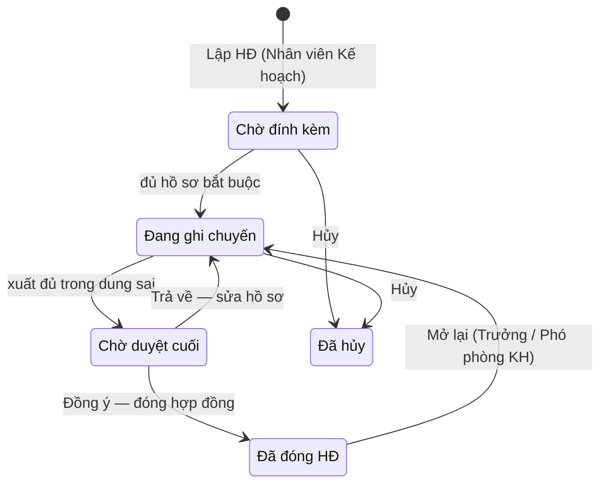
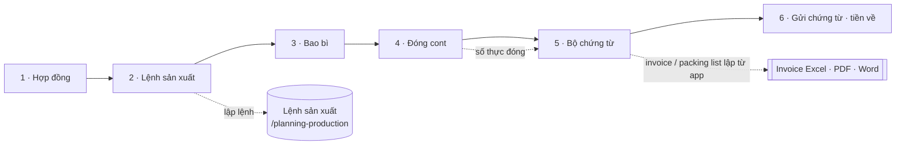
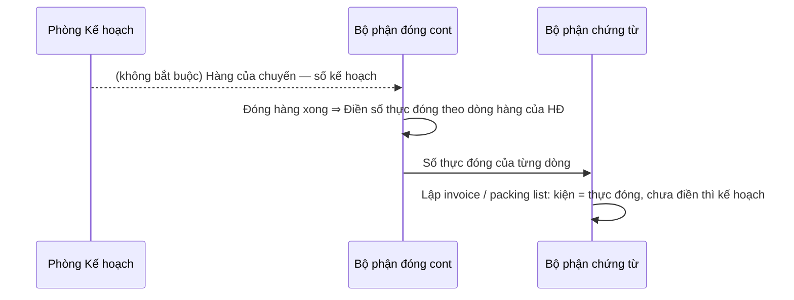

# Xuất khẩu — sơ đồ workflow

> Load khi: review / kiểm lại trang Xuất khẩu (`/planning-export`), trước khi sửa luật hợp đồng, chuyến, đóng cont, chứng từ. Bản đọc nhanh — luật đầy đủ ở ba-spec [41](../app-map/41-export-planning.ba-spec.md) · [62](../app-map/62-export-option-lists.ba-spec.md) · [63](../app-map/63-export-invoice-from-app.ba-spec.md) · [58](../app-map/58-contract-attachment-deferral.ba-spec.md).
covers: src/features/export-planning/*, src/lib/exportPlanning.ts, src/lib/exportInvoice*.ts, src/lib/exportOptions.ts, src/lib/exportFiles*.ts
tours: src/features/export-planning/exportTour.ts
guides: src/features/shared/guides/exportPlanningGuide.tsx
last_verified: 2026-11-03
ttl_days: 90

Sửa code trong `covers:` mà không sửa file này ⇒ commit bị chặn ([README](README.md) § Luật đồng bộ).

## 1. Một hợp đồng đi qua những trạng thái nào

| Trạng thái | Nghĩa | Sang bước sau khi | Ai làm | Code |
|---|---|---|---|---|
| Chờ đính kèm | HĐ vừa lập, thiếu hồ sơ bắt buộc | HĐ đã ký + L/C (nếu thanh toán L/C) mỗi loại **Có file** hoặc **Bổ sung sau** (không còn **Thiếu**). Lịch xuất dự kiến tạo được ngay | Nhân viên Kế hoạch | `contractState` · `ATTACHMENT_STATUS_LABELS` |
| Đang ghi chuyến | Ghi từng chuyến (container), theo dõi 6 bước | Tổng kg đã xuất đủ trong dung sai | Nhân viên Kế hoạch | `contractClosure` |
| Chờ duyệt cuối | Xuất đủ, chờ xem lại hồ sơ | Trưởng / Phó phòng KH chọn **Đồng ý — đóng hợp đồng**; hoặc **Trả về — sửa hồ sơ** (kèm lý do, quay lại Đang ghi chuyến) | Trưởng / Phó phòng KH | `FINAL_REVIEW_LABELS` |
| Đã đóng HĐ | Xong. Mở lại được nếu cần sửa | — | Trưởng / Phó phòng KH | `CONTRACT_STATE_LABELS` |
| Đã hủy | HĐ bỏ, chuyến không còn tính | — | Nhân viên Kế hoạch | |

Hồ sơ đính kèm **Bổ sung sau** (ba-spec 58): cho chạy tiếp nhưng vẫn nhắc ở Việc của tôi tới khi có file.

**Đọc file hợp đồng** (ba-spec [66](../app-map/66-contract-file-autofill.ba-spec.md)): ở hộp Lập HĐ / Sửa / Ghi bản sửa, chọn file Word (.docx) hoặc PDF có chữ ⇒ app điền sẵn ô **còn trống** (khách, số, ngày ký, điều khoản, dòng hàng); ô khác file chỉ liệt kê để chọn; phụ lục của HĐ khác thì không điền gì tới khi xác nhận; bản sửa nối dòng theo size, không tự xóa dòng. Không tự lưu, không tự thêm danh mục, không đổi trạng thái HĐ (`fillExportContract`, `lib/contractReader.ts`).

## 2. Một chuyến (container) đi qua 6 bước

Mỗi mục trong bước có một trong 4 nhãn: **Chưa làm** · **Đang làm** · **Xong** · **Không áp dụng** (`ITEM_STATE_LABELS`, tính ở `stepState` / `stepMissing`). Chuyến **khép** khi bước 2 → 5 đều Xong hoặc Không áp dụng; bước 6 không tính (`isShipmentClosed`).

| Bước | Mục bên trong | Xong khi (code `stepState`) | Ai làm |
|---|---|---|---|
| 1 · Hợp đồng | Hồ sơ đính kèm của HĐ | Hồ sơ bắt buộc của HĐ đủ (`contractStepState`) | Nhân viên Kế hoạch |
| 2 · Lệnh sản xuất | Lệnh sản xuất | Mục Lệnh sản xuất Xong / Không áp dụng (`subStepState`); lệnh lập ở trang Lệnh sản xuất | Nhân viên Kế hoạch |
| 3 · Bao bì | Bao bì | Mục Bao bì Xong / Không áp dụng (`subStepState`) | Nhân viên Kế hoạch |
| 4 · Đóng cont | Theo trình tự đóng thật (`LOADING_STEPS`): Lệnh xuất → Sơ đồ container → Hình ảnh đóng cont → Tờ khai | Cả 4 mục Xong / Không áp dụng **và** số container + seal hợp lệ (`containerIdentityOk`); mới có số cont / seal ⇒ Đang làm | Kế hoạch: lệnh xuất, tờ khai, số cont + seal, file booking. **Bộ phận đóng cont**: sơ đồ, ảnh |
| 4 · (không chặn) | File booking · Số lượng thực đóng · Hình ảnh bao bì + cân gross | Không tính vào bước 4 | Kế hoạch (booking) · **Bộ phận đóng cont** (số thực đóng, ảnh) |
| 5 · Bộ chứng từ | Chứng từ (Commercial Invoice, Packing List, B/L, H/C, C/O…) | Mọi mục chứng từ của chuyến Xong / Không áp dụng | Bộ phận chứng từ (Kế hoạch) |
| 6 · Gửi chứng từ · tiền về | Ghi đã gửi chứng từ, ghi tiền về | Có lần "đã gửi chứng từ" **và** tiền về ≥ giá trị chuyến; có ghi mà chưa đủ ⇒ Đang làm | Người có quyền `export-plans.payments` |

## 3. Số lượng thực đóng → invoice (ba-spec 63 R11, mig 0098)

- Chuyến chưa có hàng ⇒ hộp lấy sẵn dòng hàng của HĐ; để trống = dòng đó không đóng vào chuyến.
- Bộ phận đóng cont chỉ ghi số thực đóng (thêm dòng từ dòng HĐ được, không ghi kế hoạch, kg gross, hạn dùng, ghi chú, không xóa) — trigger `export_shipment_lines_loading_guard` (0096 → 0098).
- Phòng KH lưu Hàng của chuyến để trống kế hoạch ⇒ dòng đóng cont đã điền vẫn giữ (`linesFromDraft`).

## 4. Danh sách chọn (ba-spec 62)

Cảng xếp · cảng đích · loại container · tiền tệ · tài khoản ngân hàng: chọn từ danh sách, thêm / sửa / xóa ngay trong ô hoặc ở tab Danh mục. HĐ lưu **chữ** của mục ⇒ xóa / đổi tên mục không đổi HĐ cũ; giá trị cũ không khớp hiện "Ngoài danh sách" (`exportOptions.ts`).

## 5. Ai được làm gì

Sinh từ ma trận quyền mặc định (vai đã chỉnh ở /roles có thể khác). Admin luôn đủ quyền.

<!-- gen:roles — sinh tự động từ src/lib/permissions.ts, đừng sửa tay -->
**Kế hoạch · Xuất khẩu** (`export-plans`)

| Vai | Xem | Thêm | Sửa | Xóa | Duyệt | Xuất / In | Xem giá |
|---|---|---|---|---|---|---|---|
| Giám đốc | ✓ |  |  |  |  | ✓ | ✓ |
| Phó giám đốc | ✓ |  |  |  |  | ✓ | ✓ |
| Kế toán trưởng | ✓ |  |  |  |  | ✓ | ✓ |
| Kế toán | ✓ |  |  |  |  | ✓ | ✓ |
| Nhân viên Kế hoạch | ✓ | ✓ | ✓ | ✓ |  | ✓ | ✓ |
| Trưởng phòng Kế hoạch | ✓ | ✓ | ✓ | ✓ | ✓ | ✓ | ✓ |
| Phó phòng Kế hoạch | ✓ | ✓ | ✓ | ✓ | ✓ | ✓ | ✓ |

**Xuất khẩu · Ảnh & sơ đồ đóng cont** (`export-plans.loading`)

| Vai | Xem | Thêm |
|---|---|---|
| Giám đốc | ✓ |  |
| Phó giám đốc | ✓ |  |
| Quản đốc xưởng Đông | ✓ | ✓ |
| Quản đốc xưởng Cá | ✓ | ✓ |
| Quản đốc xưởng Khô | ✓ | ✓ |
| Phó quản đốc | ✓ | ✓ |
| Thủ kho nhập hàng | ✓ | ✓ |
| Kế toán trưởng | ✓ |  |
| Kế toán | ✓ |  |
| Nhân viên Kế hoạch | ✓ | ✓ |
| Trưởng phòng Kế hoạch | ✓ | ✓ |
| Phó phòng Kế hoạch | ✓ | ✓ |

**Xuất khẩu · Chứng từ gửi khách & tiền về** (`export-plans.payments`)

| Vai | Xem | Thêm | Sửa | Xóa |
|---|---|---|---|---|
| Giám đốc | ✓ |  |  |  |
| Phó giám đốc | ✓ |  |  |  |
| Kế toán trưởng | ✓ | ✓ | ✓ | ✓ |
| Kế toán | ✓ | ✓ | ✓ |  |
| Nhân viên Kế hoạch | ✓ | ✓ | ✓ | ✓ |
| Trưởng phòng Kế hoạch | ✓ | ✓ | ✓ | ✓ |
| Phó phòng Kế hoạch | ✓ | ✓ | ✓ | ✓ |
<!-- /gen:roles -->

## 6. Nối với module khác

| Sang | Khi nào | Luật |
|---|---|---|
| Lệnh sản xuất (`/planning-production`) | Bước 2: lập lệnh từ chuyến (`?new=1&contract=…&shipment=…`) | ba-spec 48 |
| Việc của tôi | Hồ sơ thiếu, Bổ sung sau, chuyến trễ hạn, chờ duyệt cuối | ba-spec 39 |
| Tổng quan | Khối Phòng Kế hoạch: số chuyến, trễ hạn, tiền chưa về theo tháng | spec che-do-demo §5b |

## Lịch sử

- 2026-11-03 — tạo (mẫu đầu tiên của bộ sơ đồ workflow, ba-spec 65).
- 2026-11-03 — thêm đọc file hợp đồng / phụ lục để điền sẵn form (ba-spec 66).
