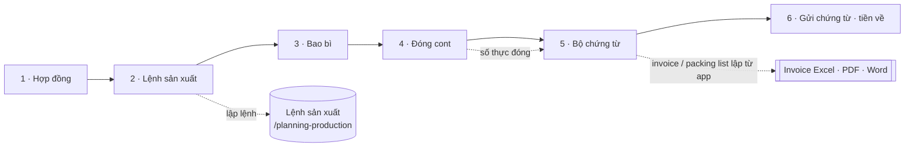
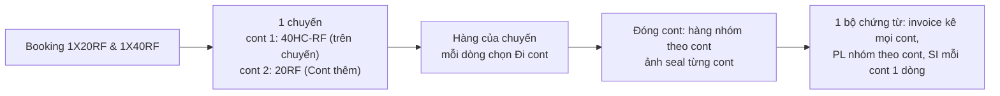
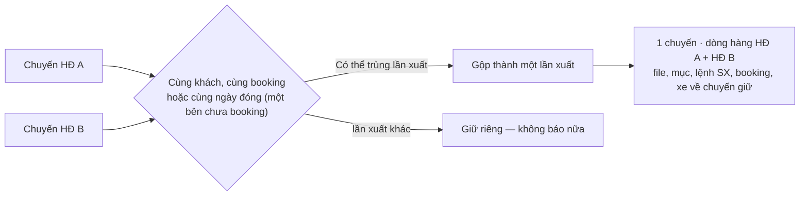
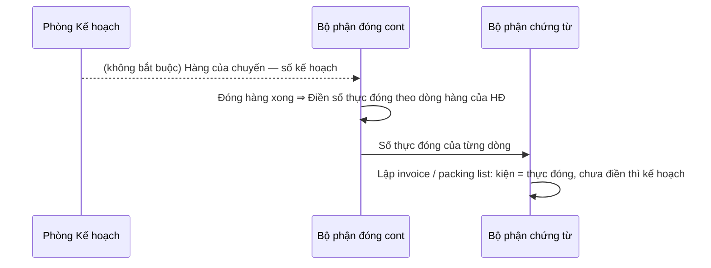

# Xuất khẩu — sơ đồ workflow

> Load khi: review / kiểm lại trang Xuất khẩu (`/planning-export`), trước khi sửa luật hợp đồng, chuyến, đóng cont, chứng từ. Bản đọc nhanh — luật đầy đủ ở ba-spec [41](../app-map/41-export-planning.ba-spec.md) · [62](../app-map/62-export-option-lists.ba-spec.md) · [63](../app-map/63-export-invoice-from-app.ba-spec.md) · [58](../app-map/58-contract-attachment-deferral.ba-spec.md).
covers: src/features/export-planning/*, src/lib/exportConsolidate.ts, src/lib/exportMergeShipments.ts, src/lib/exportPlanning.ts, src/lib/exportInvoice*.ts, src/lib/exportOptions.ts, src/lib/exportFiles*.ts, src/lib/exportContainers.ts
tours: src/features/export-planning/exportTour.ts
guides: src/features/shared/guides/exportPlanningGuide.tsx
last_verified: 2026-11-06
<!-- re-verified: 2026-11-06 (chủ dự án) — bước 5: bỏ nút Bỏ khỏi danh sách ở hàng (dễ bấm nhầm, khác cách xóa của hệ thống) ⇒ Xóa trong hộp Cập nhật, cả chứng từ HĐ yêu cầu; lưu bản sửa HĐ không thêm lại. -->
<!-- re-verified: 2026-11-06 (chị Thảo) — bước 5: Bỏ khỏi danh sách cho mọi chứng từ chưa Xong (cả HĐ yêu cầu; mục không xóa, Không áp dụng + ẩn, Hiện lại). Thay R21 cũ "chứng từ HĐ yêu cầu không xóa được — chỉ Không áp dụng". -->
<!-- re-verified: 2026-11-06 (ba-spec 74 v1.1, chủ dự án: "gộp nhưng thông tin khác nhau vẫn giữ nguyên") — gộp KHÔNG mất gì: chuyến của HĐ kia giữ bản ghi (Đã gộp vào lần xuất), ô khác nhau giữ cả hai (+ bản ghi gốc của chuyến HĐ chính), Dùng giá trị này, Tách ra chuyến riêng. -->
<!-- re-verified: 2026-11-06 (ba-spec 74) — §2d: dò chuyến có thể trùng lần xuất (cùng booking / cùng ngày đóng, cùng khách), Gộp thành một lần xuất (mang file, mục, lệnh SX, booking, xe; ô lệch chọn; Hoàn tác), Giữ riêng, lịch HĐ mới Đi chung chuyến có sẵn; bước 2 chuyến nhiều HĐ xét từng HĐ; Lịch xuất hàng một dòng ghi mọi HĐ. -->
<!-- re-verified: 2026-11-05 — SI: ô Gross mỗi kiện, Tổng gross tự nhân với số kiện; luật không đổi. -->
<!-- re-verified: 2026-11-05 — chuyến Đóng ghép có nút Đưa vào cont (một cont nhiều HĐ, §2b): hàng sang chuyến cont thành dòng của HĐ đó. -->
<!-- re-verified: 2026-11-05 — thẻ Còn … chưa ghi chuyến ghi kèm đã ghi / tối thiểu kg (HĐ, dung sai) và đã ghi / số cont; luật không đổi. -->
<!-- re-verified: 2026-11-05 — dòng HĐ đếm theo kiện: ô Kg tịnh / kiện, Thùng / kiện ghi rõ một kiện, tổng thùng hiện dưới Số lượng; luật không đổi. -->
<!-- re-verified: 2026-11-05 — bộ đọc file HĐ đọc được PDF DAIREI BD-007 (bảng tiêu đề 3 tầng, hàng tính bó, Reference Number, hạn ETA; ba-spec 66 History); không đổi luật. -->
<!-- re-verified: 2026-11-05 — nhãn trạng thái shipping "Đang giao hàng" (chặng Giao hàng), vạch chặng đang ở màu chính + dòng tiến độ; luật không đổi. -->
<!-- re-verified: 2026-11-05 — bộ đọc booking đọc được mẫu Evergreen (ba-spec 71 History); không đổi luật. -->
<!-- re-verified: 2026-11-05 (Phòng KH) — HĐ có Người nhận hàng + Notify (tên + địa chỉ, JSON terms): SI mới lấy Consignee / Notify theo HĐ (trống ⇒ khách / SI lần trước), nút Lấy theo hợp đồng; invoice + packing list theo khách hàng, sửa tay Bên mua ở phần lập invoice. Sửa lỗi Hạn hợp đồng mất khi tải lại (parseTerms bỏ sót). -->
<!-- re-verified: 2026-11-05 (ba-spec 73) — chuyến = một booking, có cont thêm (mig 0106): Số cont + seal Xong khi MỌI cont đủ số + seal + ảnh; độ phủ / báo cáo đếm cont; gộp chuyến thành cont thêm; người đóng hàng không đổi cont của dòng. -->
<!-- re-verified: 2026-11-04 (form HĐ) — nút Dùng file làm Hợp đồng đã ký; địa chỉ khách đọc từ file; kg tự tính khi sửa số lượng / kg mỗi thùng; chọn tay mặt hàng không bị gợi ý đè; Chép dòng ẩn ở dòng trống (trừ dòng 1). -->
<!-- re-verified: 2026-11-04 (KAISEI 04-26-KMP) — đơn giá 0 vì bản sửa HĐ cấp id dòng mới ⇒ bản sửa giữ id + tự nối hàng của chuyến cũ; cảnh báo invoice ghi đích danh; Packing list gross theo SI, mục PL tự điền số + ngày theo invoice. -->
<!-- re-verified: 2026-11-04 (ảnh cont / seal bắt buộc) — hàng Số cont + seal Xong khi có số VÀ ≥ 1 ảnh (ba-spec 72 R8 v1.7); chuyến cũ đã đóng xong / đóng ghép / chưa chạy 0103 không bắt. -->
<!-- re-verified: 2026-11-04 (Lệnh xuất ⇄ LSX) — bảng hàng Lệnh xuất theo từng HĐ + số lượng theo chuyến; chuyến gộp gắn / lập LSX của mọi HĐ trên chuyến (ba-spec 72 R2b, R3b; 48 LS3). -->
<!-- re-verified: 2026-11-04 — SI mở lại lấy tên hàng + HS theo HĐ hiện tại (giữ số kiện / gross đã gõ); ô Số của Lệnh xuất ghi định dạng STT/tháng-năm; không đổi luật Xong, không đổi quyền. -->
<!-- re-verified: 2026-11-04 — form Lập / Sửa HĐ thêm ô Địa chỉ khách hàng (lưu vào danh mục khách, Consignee của SI) — chị Thảo; không đổi luật, không đổi quyền. -->
<!-- re-verified: 2026-11-04 — tab Hợp đồng thêm cột Hạn hợp đồng (ngày + Còn n ngày / Đã hết hạn, sắp xếp theo ngày) — chị Thảo; chỉ hiển thị, không đổi luật. -->
<!-- re-verified: 2026-11-04 — nhãn "Kg (tự tính)" / "Kg (gõ tay)" của dòng hàng HĐ đổi thành "Kg tịnh (…)" (= số thùng × kg tịnh mỗi thùng, không phải gross); không đổi luật. -->
<!-- re-verified: 2026-11-04 — chỉ sửa chữ: title tab Lịch xuất hàng + lời tour bước "tabs" nói "xếp theo ngày xuất" (ba-spec 57 v2) thay "gom theo khách"; không đổi trạng thái, không đổi quyền. -->
<!-- re-verified: 2026-11-04 (ba-spec 72) — bước 4: Lệnh xuất lập trong app (bộ soạn, xuất Word = Xong), mục SI bắt buộc ngay sau Số cont + seal (chuyến cont lạnh; cũ / xe tải / đóng ghép Không áp dụng), ảnh cont / seal (người đóng hàng đính được — đổi RLS export_files 0103). -->
<!-- re-verified: 2026-11-03 (ba-spec 71) — bước 4: hàng File booking thành khối Booking 12 trường (đọc file booking) + hàng Thông tin xe vận chuyển; không trạng thái, không đổi 6 bước, không đổi quyền (người đóng hàng chỉ xem). -->
<!-- re-verified: 2026-11-03 (ba-spec 70 đợt 1) — chuyến gộp nhiều HĐ cùng khách (§2b); không đổi trạng thái HĐ / 6 bước, luật đóng cont cho dòng HĐ phụ ở mig 0102. -->
<!-- re-verified: 2026-11-03 (ba-spec 69) — thêm Hạn hợp đồng (ô điều khoản, hồ sơ HĐ, bộ đọc file); không đổi trạng thái HĐ / chuyến, không đổi quyền. -->
<!-- re-verified: 2026-11-03 (ba-spec 66 v1.2) — khối Đọc file hợp đồng (`ContractReadPanel.tsx`, tour) — đọc thêm .doc + bảng Excel nhúng + bảng PDF theo tọa độ; không đổi trạng thái, không đổi quyền. -->
ttl_days: 90

Sửa code trong `covers:` mà không sửa file này ⇒ commit bị chặn ([README](README.md) § Luật đồng bộ).

## 1. Một hợp đồng đi qua những trạng thái nào

| Trạng thái | Nghĩa | Sang bước sau khi | Ai làm | Code |
|---|---|---|---|---|
| Chờ đính kèm | HĐ vừa lập, thiếu hồ sơ bắt buộc | HĐ đã ký + L/C (nếu thanh toán L/C) mỗi loại **Có file** hoặc **Bổ sung sau** (không còn **Thiếu**). Lịch xuất dự kiến tạo được ngay | Nhân viên Kế hoạch | `contractState` · `ATTACHMENT_STATUS_LABELS` |
| Đang giao hàng | Ghi chuyến, làm từng chuyến qua 6 bước (trước 2026-11-05 tên là "Đang ghi chuyến"; chặng trên thanh: **Giao hàng**) | Mọi chuyến có hàng của HĐ đã khép **và** tổng đã giao trong dung sai — ghi đủ chuyến chưa phải là xong | Nhân viên Kế hoạch | `contractClosure` |
| Chờ duyệt cuối | Xuất đủ, chờ xem lại hồ sơ | Trưởng / Phó phòng KH chọn **Đồng ý — đóng hợp đồng**; hoặc **Trả về — sửa hồ sơ** (kèm lý do, quay lại Đang giao hàng) | Trưởng / Phó phòng KH | `FINAL_REVIEW_LABELS` |
| Đã đóng HĐ | Xong. Mở lại được nếu cần sửa | — | Trưởng / Phó phòng KH | `CONTRACT_STATE_LABELS` |
| Đã hủy | HĐ bỏ, chuyến không còn tính | — | Nhân viên Kế hoạch | |

Hồ sơ đính kèm **Bổ sung sau** (ba-spec 58): cho chạy tiếp nhưng vẫn nhắc ở Việc của tôi tới khi có file.

Hồ sơ chỉ tính theo **loại** (`missingAttachmentKinds`). File ký đính dạng Phụ lục / file kèm, hoặc nằm ở file của bản HĐ ⇒ hàng Thiếu có nút **Dùng "…" làm Hợp đồng đã ký** (`attachmentCandidates`): file đính ⇒ đổi loại; file của bản ⇒ thêm dòng hồ sơ cùng file (có Hoàn tác). Đọc file HĐ dạng tên hàng một lần rồi "Specification 1, 2…" (Peacock): mỗi spec một dòng, chép tên hàng + quy cách đóng gói của dòng trên (như Chép dòng), hàng mô tả tiếp ("- Length …") ghép vào spec, tách size / số miếng / chiều dài / tỉ lệ. Đọc Cảng đích: bỏ chữ tiêu đề cột sau "Price CFR", tìm tiếp "CFR <cảng>" / "Port of discharge / Discharging port / Destination / Cảng đến", so tên thành phố bỏ "port / cảng" với danh sách Cảng đích. Dòng HĐ có ô **Thời gian chần / luộc** (`cookTime`, đọc từ cột Boiling / Blanching time hoặc chữ spec) ⇒ chép vào Quy cách dòng Lệnh sản xuất. Form HĐ: đọc file điền cả địa chỉ khách (dòng Add dưới THE BUYER); sửa số lượng / kg mỗi thùng ⇒ kg tịnh về tự tính; chọn tay mặt hàng thì gợi ý không đè, đổi mặt hàng lần 2, 3 ăn ngay (`lineTextAfterPick` chỉ trả ô chữ).

**Đọc file hợp đồng** (ba-spec [66](../app-map/66-contract-file-autofill.ba-spec.md)): ở hộp Lập HĐ / Sửa / Ghi bản sửa, chọn file Word (.docx) hoặc PDF có chữ ⇒ app điền sẵn ô **còn trống** (khách, số, ngày ký, điều khoản, dòng hàng); ô khác file chỉ liệt kê để chọn; phụ lục của HĐ khác thì không điền gì tới khi xác nhận; bản sửa nối dòng theo size, không tự xóa dòng. Không tự lưu, không tự thêm danh mục, không đổi trạng thái HĐ (`fillExportContract`, `lib/contractReader.ts`).

### Sửa hợp đồng: sửa được gì, khóa khi nào (ba-spec [68](../app-map/68-export-contract-edit.ba-spec.md))

| Việc | Được khi | Khóa khi | Code |
|---|---|---|---|
| Sửa hợp đồng (sửa thẳng bản đang dùng, không thêm bản) | HĐ còn mở **và** chưa chuyến nào có mã lô, booking, ngày, số cont hay file | có chuyến đã ghi thông tin ⇒ dùng Ghi bản sửa | `canEditContractDirectly` |
| Ghi bản sửa (bản mới có hiệu lực ngay, bản cũ giữ để tra) | HĐ còn mở, có bản hiệu lực (kể cả đang Chờ duyệt cuối) | Đã đóng HĐ · Đã hủy | `ContractDossier` menu |
| Số hợp đồng | mọi lần Sửa / Ghi bản sửa; không trùng số HĐ khác của cùng khách | Đã đóng HĐ · Đã hủy | `validateContract` |
| Khách | tới khi một chuyến xong bước 4 Đóng cont | có chuyến xong bước 4 | `customerChangeGate` |
| Mở lại HĐ đã đóng | Trưởng / Phó phòng KH | — | |

Mỗi lần lưu, nhật ký Xuất khẩu ghi từng ô đổi **cũ → mới**: Số HĐ, Khách, Ngày ký, Số PO, điều khoản (cảng, thanh toán, hạn giao, dung sai, cont…), dòng hàng thêm / bớt / sửa (`contractChangeSummary`). Bản sửa không lưu riêng số HĐ ⇒ số cũ chỉ còn ở nhật ký.
## 2. Một chuyến (một booking · một hay nhiều cont) đi qua 6 bước

Mỗi mục trong bước có một trong 4 nhãn: **Chưa làm** · **Đang làm** · **Xong** · **Không áp dụng** (`ITEM_STATE_LABELS`, tính ở `stepState` / `stepMissing`). Chuyến **khép** khi bước 2 → 5 đều Xong hoặc Không áp dụng; bước 6 không tính (`isShipmentClosed`).

| Bước | Mục bên trong | Xong khi (code `stepState`) | Ai làm |
|---|---|---|---|
| 1 · Hợp đồng | Hồ sơ đính kèm của HĐ | Hồ sơ bắt buộc của HĐ đủ (`contractStepState`) | Nhân viên Kế hoạch |
| 2 · Lệnh sản xuất | Lệnh sản xuất | Mục Lệnh sản xuất Xong / Không áp dụng (`subStepState`); lệnh lập ở trang Lệnh sản xuất. Chuyến **nhiều HĐ** (2026-11-06, ba-spec 74 R14): Xong khi **mọi** HĐ trên chuyến có lệnh đã phát hành gắn chuyến; mới một phần ⇒ Đang làm + kể HĐ thiếu (`productionOrderMissingContracts`) | Nhân viên Kế hoạch |
| 3 · Bao bì | Bao bì | Mục Bao bì Xong / Không áp dụng (`subStepState`) | Nhân viên Kế hoạch |
| 4 · Đóng cont | Theo trình tự đóng thật (`LOADING_STEPS`): Lệnh xuất → (số cont + seal) → **SI** (ba-spec [72](../app-map/72-export-order-and-si.ba-spec.md), ngay sau số cont + seal; máy chủ đã chạy 0103) → Sơ đồ container → Hình ảnh đóng cont → Tờ khai | Cả các mục Xong / Không áp dụng **và** hàng Số cont + seal Xong (`containerSealState`): số container + seal hợp lệ (`containerIdentityOk`; xe tải: biển số) **và có ≥ 1 ảnh cont / seal** (từ 04/11/2026, Phòng KH yêu cầu; đóng ghép, máy chủ chưa chạy 0103, chuyến tạo trước 05/11/2026 đã có B/L hoặc đã xong 4 mục cũ + số ⇒ không bắt ảnh — `containerSealPhotoRequired`); mới có số hoặc ảnh ⇒ Đang làm. Lệnh xuất Xong khi có file — xuất Word từ **Lập lệnh xuất** là đủ. SI (`shippingInstructionState`) Xong khi có file SI; xe tải / đóng ghép ⇒ Không áp dụng; chuyến tạo trước 05/11/2026 đã xong bước 4 cũ hoặc có B/L ⇒ Không áp dụng nhưng vẫn lập SI được (lập xong ⇒ Xong) — `shippingInstructionExemption` cho lý do | Kế hoạch: lệnh xuất, SI, tờ khai, số cont + seal, file booking. **Bộ phận đóng cont**: sơ đồ, ảnh, ảnh cont / seal |
| 4 · (không chặn) | Booking (12 trường + file booking, ba-spec [71](../app-map/71-export-booking-details.ba-spec.md)) · Thông tin xe vận chuyển · Số lượng thực đóng · Hình ảnh bao bì + cân gross | Không tính vào bước 4. Thông tin xe chỉ lưu khi đủ 4 ô bắt buộc (công ty vận chuyển, nơi lấy rỗng, nơi đóng, nơi hạ bãi) | Kế hoạch (booking, thông tin xe; bộ phận đóng cont chỉ xem) · **Bộ phận đóng cont** (số thực đóng, ảnh) |
| 5 · Bộ chứng từ | Chứng từ (Commercial Invoice, Packing List, B/L, H/C, C/O…) | Mọi mục chứng từ của chuyến Xong / Không áp dụng. Chuyến không có một chứng từ (kể cả HĐ yêu cầu) ⇒ **Xóa** trong hộp Cập nhật (hỏi lại, Hoàn tác); trừ Commercial Invoice, mục Xong / dùng chung (`deleteDocumentGate`). Lưu bản sửa HĐ chỉ thêm chứng từ **mới** được yêu cầu, không thêm lại chứng từ chuyến đã xóa (`newlyRequiredDocumentItems`). Mục "bỏ khỏi danh sách" bằng nút cũ (bản 06/11) vẫn ẩn (`isRemovedDocumentItem`) | Bộ phận chứng từ (Kế hoạch) |
| 5 · Invoice · Packing list lập từ app | Số B/L in trên invoice gõ ở phần lập invoice (`comp.blNo`), trống ⇒ số ở mục Bill of Lading. Đơn giá mặc định theo dòng HĐ của bản đang dùng (`invoiceUnitPrice`); hàng của chuyến trỏ id dòng của bản HĐ cũ ⇒ tự nối sang dòng tương ứng (`remapLegacyContractLineIds`, khớp mặt hàng + size + tên, không được thì cùng vị trí). Dòng thiếu số kiện / kg/thùng / đơn giá ⇒ in trống tiền, khung tóm tắt ghi đích danh (`incompleteLines`). Packing list: số, ngày, lượng theo invoice; gross theo SI đã lưu (`siGrossByLine`), chưa có SI ⇒ kg cả bì × số kiện. Mục Packing List tự điền số + ngày theo Commercial Invoice khi còn trống; nút **Tạo file Packing list từ invoice** tạo PDF chỉ gồm Packing list (+ Expiry date list) và đưa vào ô file của mục (`packingListPdfFile`) | Bộ phận chứng từ |
| Bản sửa HĐ | Giữ id dòng hàng của bản trước (từ 04/11/2026) — hàng của chuyến, lệnh sản xuất, invoice vẫn nối đúng dòng | Phòng KH |
| 6 · Gửi chứng từ · tiền về | Ghi đã gửi chứng từ, ghi tiền về | Có lần "đã gửi chứng từ" **và** tiền về ≥ giá trị chuyến; có ghi mà chưa đủ ⇒ Đang làm | Người có quyền `export-plans.payments` |

## 2b. Một chuyến chở hàng của nhiều HĐ cùng khách (ba-spec [70](../app-map/70-call-off-schedule-multi-contract.ba-spec.md))

Khách như DAIREI ký nhiều HĐ song song (mỗi HĐ một mã hàng, lượng cả năm, giao từng phần), mỗi tháng một cont gộp hàng của các HĐ.

| Việc | Luật | Code |
|---|---|---|
| Thêm hàng của HĐ khác vào chuyến | HĐ cùng khách với HĐ chính của chuyến, còn mở, có bản hiệu lực, không còn hồ sơ bắt buộc **Thiếu** | `addContractGate` · `addableContracts` |
| HĐ của chuyến | HĐ chính + HĐ của từng dòng hàng; chuyến cũ chưa có dòng ⇒ chỉ HĐ chính | `shipmentContractIds` |
| Đã giao của HĐ trên chuyến gộp | Cộng từ dòng của HĐ: kiện (thực đóng, chưa có thì kế hoạch) × kg/kiện; tiền = kg × đơn giá (invoice sửa ⇒ số đó). Chuyến một HĐ ⇒ theo Commercial Invoice như cũ | `shipmentContractActuals` · `contractActuals` |
| HĐ xong | Mọi chuyến **có hàng của HĐ** đã khép + đã giao trong dung sai (lượng và tiền). Không xét từng tháng | `contractClosure` |
| Bước 1 của chuyến gộp | Xong khi mọi HĐ của chuyến đủ hồ sơ | `stepState(…, 1)` |
| Hạn giao, trễ | Hạn sớm nhất trong các HĐ của chuyến | `shipmentDeadline` |
| Tiền về | Ghi theo chuyến; phần của HĐ = tiền về × tiền dòng của HĐ ÷ tiền cả chuyến | `contractPaymentSummary` |
| Chứng từ | Một bộ cho chuyến; mỗi dòng in kèm "(Contract No. …)" của HĐ gốc | `linesWithContractNo` |
| Hồ sơ HĐ phụ | Mục **Đi chung chuyến của hợp đồng khác**: chỉ xem, các bước theo dõi ở hồ sơ HĐ chính | `carriesContract` |
| Khóa đổi khách, xóa HĐ | Tính cả chuyến gộp có hàng của HĐ | `customerChangeGate` · `canDeleteContract` |
| Lệnh sản xuất của chuyến gộp | Gắn / lập được lệnh của mọi HĐ có hàng trên chuyến (mỗi HĐ một nút **Lập lệnh sản xuất · HĐ …**). Bước 2 Xong khi chuyến gắn ≥ 1 lệnh đã phát hành (luật cũ) | `ShipmentOrders` · `openShipmentsOf` |
| Đưa chuyến Đóng ghép vào cont (2026-11-05) | Chuyến **Đóng ghép** còn mở, chưa file / chưa bước Xong ⇒ **Đưa vào cont** của chuyến cont lạnh còn mở, cùng khách (HĐ khác qua cổng thêm HĐ). Hàng thành dòng của HĐ đó trên chuyến cont (chưa có dòng ⇒ dựng từ kg: HĐ một dòng ⇒ số kiện = kg ÷ kg/kiện; nhiều dòng ⇒ dòng trống + nhắc); chuyến cont chưa có dòng ⇒ dựng dòng HĐ chính từ kg của nó; kg kế hoạch cộng dồn; chuyến Đóng ghép bỏ, một Hoàn tác. Gợi ý: cùng booking → cùng ngày đóng → ngày gần | `consolidateGate` · `consolidateTargets` · `consolidateInto` |
| Bảng hàng của Lệnh xuất | Xét từng HĐ: HĐ có lệnh sản xuất đã phát hành gắn chuyến ⇒ tên hàng, MSL, ngày SX, hạn theo lệnh; HĐ chưa có lệnh ⇒ theo Hàng của chuyến. Số thùng + kg theo Hàng của chuyến (thực đóng, chưa có thì kế hoạch); chuyến chưa nhập Hàng của chuyến ⇒ số cả lệnh + cảnh báo (ba-spec [72](../app-map/72-export-order-and-si.ba-spec.md) R2b, R3b) | `buildExportOrderLines` |

Bộ phận đóng cont ghi số thực đóng cho dòng của HĐ phụ đã có trên chuyến (cùng khách) — mig `0102` (đã chạy DB thật). Đóng cont không tự đưa HĐ mới vào chuyến.

Chưa làm (ba-spec 70): khung giao ETA từ – tới (NL8), lịch gọi hàng của khách (đợt 2).

## 2c. Một chuyến nhiều cont — một booking "1X20RF & 1X40RF" (ba-spec [73](../app-map/73-shipment-multi-container.ba-spec.md), mig `0106`)

Chuyến = **một booking / một lần xuất**. Cont 1 = Loại chuyến + Số container + Seal của chuyến (như cũ); cont 2…n ở bảng `export_shipment_containers`. Chuyến cũ = 1 cont, không đổi gì. Máy chủ chưa chạy 0106 ⇒ ẩn khối Cont thêm, mọi thứ như trước.

| Việc | Luật | Code |
|---|---|---|
| Thêm / bỏ cont | Sửa chuyến → khối **Cont thêm** (chỉ chuyến cont lạnh, loại 20RF / 40RF / 40HC-RF); bỏ cont còn dòng hàng ⇒ chặn, kể dòng; đổi chuyến sang xe tải / đóng ghép khi còn cont thêm ⇒ lỗi | `extraContainersOf` · `removeContainerGate` |
| Số cont | 11 ký tự (gõ sau được); hai cont trong chuyến không trùng số | `validateExtraContainers` |
| Booking nhiều cont | Cập nhật booking đọc "1X20RF & 1X40RF" ⇒ hỏi Có / Không thêm cont (cont 1 = loại lớn nhất); Có mới ghi | `bookingContainerKinds` |
| Dòng hàng | Mỗi dòng một cont (trống = cont 1; cont đã xóa ⇒ cont 1); dòng đi hai cont ⇒ **Chia sang cont khác** | `linesByContainer` · `splitRow` |
| Số cont + seal | Xong khi **mọi** cont có số hợp lệ + seal + (≥ 1 ảnh của cont đó khi bắt ảnh); ảnh không gắn cont = cont 1 | `containerSealState` · `filesOfContainer` |
| Lệnh xuất | "1 x 40HC-RF + 1 x 20RF" (cùng loại ⇒ "2 x 40RF"); bảng hàng theo cont, Word ghi [Cont n · loại] trước tên hàng | `containerQuantityText` · `buildExportOrderLines` |
| Invoice / PL | Đầu trang kê mọi cont; Packing list mỗi cont một nhóm + dòng cộng; cộng các cont == tổng invoice | `buildInvoiceDocument` (`containerTotals`) |
| SI | Mỗi cont: số, seal, loại, số kiện, gross; 2 cont đầu ở A33–A36, cont thứ 3 trở đi ghi thêm ở A36 / C35 | `siContainerRows` · `fillShippingInstruction` |
| Độ phủ HĐ, báo cáo | Đếm **cont**, không đếm chuyến | `containerCountOf` · `contractCoverage` · `buildExportReport` |
| Gộp chuyến | Lịch chia 2 chuyến mà booking ra một lần: chuyến cùng HĐ, chưa file, chưa bước Xong, không khác booking ⇒ **Gộp làm cont thêm** (hàng đi theo, một Hoàn tác) | `mergeShipmentGate` · `mergeShipmentInto` |
| Đã giao, tiền về, trễ | Không đổi — theo chuyến (invoice), chuyến gộp nhiều HĐ theo dòng | — |
| Người đóng hàng | Xem cont, điền số thực đóng, đính ảnh từng cont; **không** thêm cont, không đổi cont của dòng (trigger 0106) | `export_shipment_lines_loading_guard` |

Khách đòi invoice / B/L riêng từng cont ⇒ vẫn dùng nhiều chuyến cùng booking + chứng từ **dùng chung** (luật cũ).

## 2d. Một lần xuất của nhiều HĐ = một chuyến (ba-spec [74](../app-map/74-merge-shipments-one-export.ba-spec.md), 2026-11-06)

Lịch từng HĐ dựng mỗi HĐ một chuyến ⇒ một cont thật thành 2–4 chuyến (DAIREI: 35 chuyến mở / 13 lần xuất; 06/11 BD-007 + BD-008 cùng booking SGNGCZ486800 phải gõ booking, xe, ảnh 2 lần).

| Việc | Luật | Code |
|---|---|---|
| Dò trùng | Chuyến **mở**, cùng khách; cùng booking (bỏ khoảng trắng, không phân biệt hoa thường) **hoặc** cùng ngày đóng mà một bên chưa booking; bắc cầu. Cùng ngày khác booking ⇒ không báo. Báo ở Lịch xuất hàng (thẻ Có thể trùng ở ngày, khung vàng trong ngày) + hồ sơ chuyến | `duplicateShipmentGroups` · `sameExport` |
| Giữ riêng | Ghi nhật ký (dấu máy đọc, không cột mới); không báo nữa cho đúng tập chuyến đó; thêm chuyến mới vào nhóm ⇒ báo lại | `keptSeparateSets` |
| HĐ chính của lần xuất | Chuyến của HĐ chính thành chuyến chung. Mặc định: nhiều file → nhiều mục Xong → nhiều ô đã điền → tạo sớm; đổi được trong hộp | `defaultKeeper` |
| Cổng gộp | Mở; cùng khách; không có gửi chứng từ / tiền về (cả hai chuyến); không có mục cùng loại đã làm ở **cả hai**; chuyến bỏ đã có file / mục Xong ⇒ HĐ của nó qua cổng thêm HĐ (không còn Thiếu); chuyến chỉ là kế hoạch ⇒ chỉ cần HĐ mở + có bản | `mergeGate` |
| Không mất gì (v1.1) | Chuyến của HĐ kia **không xóa**: giữ nguyên bản ghi (booking, xe, kg, ngày như lúc nhập), trạng thái "Đã gộp vào lần xuất …" (hủy + dấu chuyến chung ⇒ mọi luật bỏ chuyến hủy vẫn đúng), mở xem được, có nút Mở lần xuất; không Khôi phục / Xóa được. Mục bước trống của nó nằm lại bản ghi | `mergedIntoId` · `mergedChildren` |
| Ô ghi khác nhau | Không bắt chọn: chuyến chung dùng giá trị của HĐ chính, trống thì bù từ HĐ kia; giá trị kia còn ở bản ghi và hiện ở khối **Lần xuất gồm** (✓ = đang dùng), **Dùng giá trị này** để đổi. Có ô khác nhau ⇒ giữ thêm **bản ghi gốc của chuyến HĐ chính** (đổi giá trị không làm mất giá trị cũ). Nhật ký gộp ghi đủ các giá trị | `fieldDifferences` · `withFieldValue` |
| Tách ra chuyến riêng | HĐ không phải HĐ chính, có hàng trên chuyến, chưa gửi chứng từ / tiền về. Có bản ghi chuyến cũ ⇒ mở lại đúng bản ghi đó; HĐ đi chung từ lịch ⇒ chuyến mới chép booking / ngày (không chép số cont, xe). Đi theo: dòng hàng của HĐ, file đính cho HĐ đó, lệnh sản xuất của HĐ; mục chứng từ đã làm chung ở lại chuyến chung | `splitGate` · `splitContract` |
| Đi theo | Dòng hàng (chưa có ⇒ dựng từ kg như Đưa vào cont), kg cộng, file (trùng tên giữ cả hai + báo), mục bước (mục có tiến độ thắng mục trống), mục "dùng chung" trỏ lại, lệnh SX gắn chuyến, cont thêm. Loại: chuyến giữ Đóng ghép + chuyến bỏ cont lạnh ⇒ cont lạnh | `mergeShipments` |
| Cách gộp | Cùng một cont (mặc định) · Mỗi chuyến một cont (chuyến bỏ thành cont thêm — 73 R13 cho cả HĐ khác) | `MergeMode` |
| Sau gộp | Một Hoàn tác; nhật ký mọi HĐ ghi một dòng gộp; link chuyến đã gộp mở bản ghi đó + nút Mở lần xuất; tra cứu ra chuyến chung | `mergedInto` |
| Lập lịch HĐ mới | Dòng lịch trùng ngày đóng / booking với chuyến mở của HĐ khác cùng khách ⇒ chọn sẵn **Đi chung chuyến**: thêm dòng hàng HĐ vào chuyến đó, không tạo chuyến mới; **Tạo chuyến riêng** vẫn được | `jointShipmentsFor` · `applyScheduleRows` |
| Ghi booking / chuyến | Booking hoặc ngày trùng chuyến khác cùng khách ⇒ lưu được, thông báo mời gộp | `sameExportShipments` |
| Lịch xuất hàng | Chuyến nhiều HĐ một dòng: "HĐ BD-008/26 + BD-007/26", kg từng HĐ; tra số HĐ phụ ra chuyến | `plannedKgByContract` · `searchShipments` |
| Quyền | Gộp: `export-plans` Sửa + Xóa; Giữ riêng: Sửa | — |

## 3. Số lượng thực đóng → invoice (ba-spec 63 R11, mig 0098)

- Chuyến chưa có hàng ⇒ hộp lấy sẵn dòng hàng của HĐ; để trống = dòng đó không đóng vào chuyến.
- Bộ phận đóng cont chỉ ghi số thực đóng (thêm dòng từ dòng HĐ được, không ghi kế hoạch, kg gross, hạn dùng, ghi chú, không xóa) — trigger `export_shipment_lines_loading_guard` (0096 → 0098).
- Phòng KH lưu Hàng của chuyến để trống kế hoạch ⇒ dòng đóng cont đã điền vẫn giữ (`linesFromDraft`).

## 4. Danh sách chọn (ba-spec 62)

Cảng xếp · cảng đích · loại container · tiền tệ · tài khoản ngân hàng: chọn từ danh sách, thêm / sửa / xóa ngay trong ô hoặc ở tab Danh mục. HĐ lưu **chữ** của mục ⇒ xóa / đổi tên mục không đổi HĐ cũ; giá trị cũ không khớp hiện "Ngoài danh sách" (`exportOptions.ts`).

## Thông tin người bán trên chứng từ (ba-spec 67)

Tên, địa chỉ (tiếng Anh, viết hoa), nơi lập, tên viết tắt ở chỗ ký và logo PDF / Word lấy từ **Tài liệu công ty → Thông tin công ty**; chưa có ⇒ giá trị đang in trên invoice 236/26. Tài khoản ngân hàng cũng quản lý ở đó (không còn ở tab Danh mục), invoice chọn một tài khoản như cũ.

### Dòng hàng: gợi ý mặt hàng

Gõ Tên hàng (như trên HĐ) hoặc Size xong ⇒ gợi ý Mặt hàng (danh mục) theo 3 bậc: tên hàng của khách (+ size) → dòng HĐ trước cùng tên (+ size; cùng khách, mới nhất thắng) → tên thương mại. Mỗi bậc thử **nguyên văn** rồi **gần đúng** (bỏ dấu, dấu câu, khoảng trắng, "gr" = "g"). Nhiều mặt hàng cùng khớp ⇒ không gợi ý. Dòng do app gợi ý ghi nguồn + "gần giống"; người dùng chọn tay thì app không đổi nữa (`suggestProductMatch`).
## 5. Ai được làm gì

Sinh từ ma trận quyền mặc định (vai đã chỉnh ở /roles có thể khác). Admin luôn đủ quyền.

<!-- gen:roles — sinh tự động từ src/lib/permissions.ts, đừng sửa tay -->
**Kế hoạch · Xuất khẩu** (`export-plans`)

| Vai | Xem | Thêm | Sửa | Xóa | Duyệt | Xuất / In | Xem giá |
|---|---|---|---|---|---|---|---|
| Giám đốc | ✓ |  |  |  |  | ✓ | ✓ |
| Phó giám đốc | ✓ |  |  |  |  | ✓ | ✓ |
| Kế toán trưởng | ✓ |  |  |  |  | ✓ | ✓ |
| Kế toán | ✓ |  |  |  |  | ✓ | ✓ |
| Nhân viên Kế hoạch | ✓ | ✓ | ✓ | ✓ |  | ✓ | ✓ |
| Trưởng phòng Kế hoạch | ✓ | ✓ | ✓ | ✓ | ✓ | ✓ | ✓ |
| Phó phòng Kế hoạch | ✓ | ✓ | ✓ | ✓ | ✓ | ✓ | ✓ |

**Xuất khẩu · Ảnh & sơ đồ đóng cont** (`export-plans.loading`)

| Vai | Xem | Thêm |
|---|---|---|
| Giám đốc | ✓ |  |
| Phó giám đốc | ✓ |  |
| Quản đốc xưởng Đông | ✓ | ✓ |
| Quản đốc xưởng Cá | ✓ | ✓ |
| Quản đốc xưởng Khô | ✓ | ✓ |
| Phó quản đốc | ✓ | ✓ |
| Thủ kho nhập hàng | ✓ | ✓ |
| Kế toán trưởng | ✓ |  |
| Kế toán | ✓ |  |
| Nhân viên Kế hoạch | ✓ | ✓ |
| Trưởng phòng Kế hoạch | ✓ | ✓ |
| Phó phòng Kế hoạch | ✓ | ✓ |

**Xuất khẩu · Chứng từ gửi khách & tiền về** (`export-plans.payments`)

| Vai | Xem | Thêm | Sửa | Xóa |
|---|---|---|---|---|
| Giám đốc | ✓ |  |  |  |
| Phó giám đốc | ✓ |  |  |  |
| Kế toán trưởng | ✓ | ✓ | ✓ | ✓ |
| Kế toán | ✓ | ✓ | ✓ |  |
| Nhân viên Kế hoạch | ✓ | ✓ | ✓ | ✓ |
| Trưởng phòng Kế hoạch | ✓ | ✓ | ✓ | ✓ |
| Phó phòng Kế hoạch | ✓ | ✓ | ✓ | ✓ |
<!-- /gen:roles -->

## 6. Nối với module khác

| Sang | Khi nào | Luật |
|---|---|---|
| Lệnh sản xuất (`/planning-production`) | Bước 2: lập lệnh từ chuyến (`?new=1&contract=…&shipment=…`) | ba-spec 48 |
| Việc của tôi | Hồ sơ thiếu, Bổ sung sau, chuyến trễ hạn, chờ duyệt cuối | ba-spec 39 |
| Tổng quan | Khối Phòng Kế hoạch: số chuyến, trễ hạn, tiền chưa về theo tháng | spec che-do-demo §5b |

## Lịch sử

- 2026-11-06 — §2d một lần xuất nhiều HĐ = một chuyến (ba-spec 74).
- 2026-11-05 — §2c chuyến nhiều cont (ba-spec 73, mig 0106).

- 2026-11-03 — bảng sửa / khóa hợp đồng; Số HĐ đổi được ở Ghi bản sửa (ba-spec 68).
- 2026-11-03 — tạo (mẫu đầu tiên của bộ sơ đồ workflow, ba-spec 65).
- 2026-11-03 — thêm đọc file hợp đồng / phụ lục để điền sẵn form (ba-spec 66).
