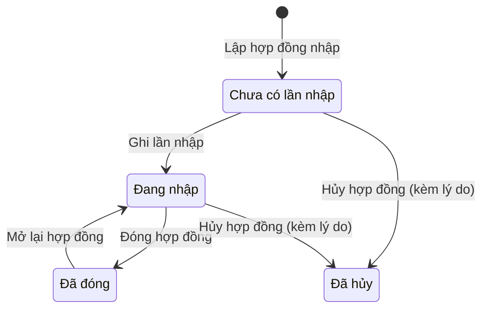
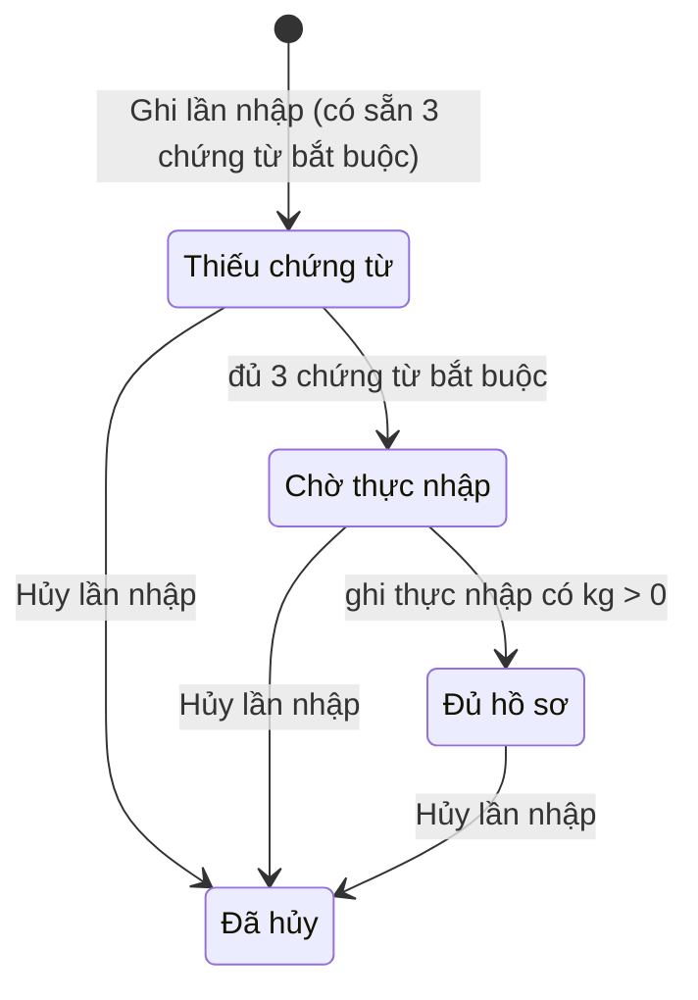
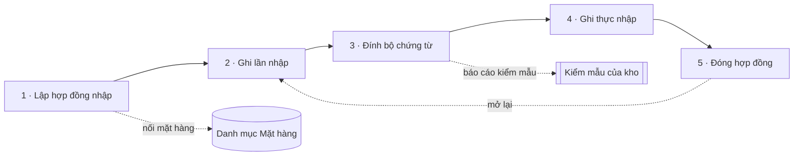
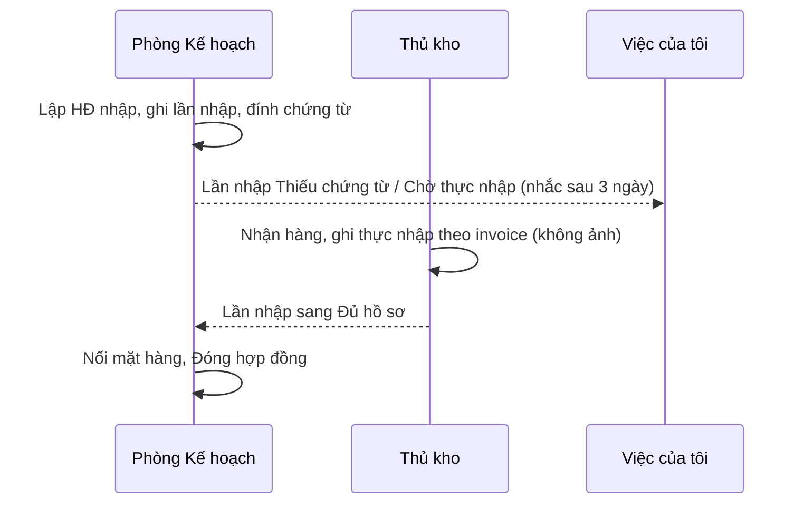

# Nhập khẩu — sơ đồ workflow

> Load khi: review / kiểm lại trang Nhập khẩu (`/planning-import`), trước khi sửa luật hợp đồng nhập, lần nhập, bộ chứng từ, thực nhập, đóng hợp đồng. Bản đọc nhanh — luật đầy đủ ở ba-spec [45](../app-map/45-import-planning.ba-spec.md) · design-spec [46](../app-map/46-import-planning-ui.design-spec.md). "Nhập khẩu" khác "Nhập hàng" (`/imports`, mua nguyên liệu trong nước).
covers: src/features/import-planning/*, src/lib/importPlanning.ts, src/lib/importPlanningDemo.ts, src/lib/importReports.ts, src/lib/importSample*.ts, src/lib/importFileStorage.ts
tours: src/features/import-planning/importTour.ts
guides: src/features/shared/guides/importPlanningGuide.tsx
last_verified: 2026-11-03
<!-- re-verified: 2026-11-03 (ba-spec 69 v2) — HĐ nhập thêm Hạn hợp đồng (ô form, hồ sơ, bộ đọc file; mig 0100); không đổi trạng thái HĐ / lần nhập, không đổi quyền. -->
<!-- re-verified: 2026-11-03 (ba-spec 66 v1.2) — tour Lập hợp đồng nhập — đọc thêm .doc; dạng nhãn : giá trị của HĐ NCC Ấn Độ; không đổi trạng thái, không đổi quyền. -->
ttl_days: 90
<!-- re-verified: 2026-11-03 — khối Đọc file hợp đồng ở hộp Lập / Sửa HĐ nhập (`ImportDialogs.tsx`, `fillImportContract`) khớp đoạn "Đọc file hợp đồng" ở §1 (ba-spec 66); không đổi trạng thái, không đổi quyền. -->

Sửa code trong `covers:` mà không sửa file này ⇒ commit bị chặn ([README](README.md) § Luật đồng bộ).

## 1. Hợp đồng nhập và lần nhập đi qua những trạng thái nào

Hai đối tượng. **Hợp đồng nhập** (đối tác nước ngoài, dòng hàng tên · kg · đơn giá) có 1..n **lần nhập** (một cont hoặc hàng lẻ về kho). Không có bước thanh toán, không có bước duyệt.

| Trạng thái HĐ | Nghĩa | Sang bước sau khi | Ai làm | Code |
|---|---|---|---|---|
| Chưa có lần nhập | HĐ vừa lập, chưa có lần hàng về | Ghi ít nhất một lần nhập chưa hủy. Xóa HĐ chỉ được ở trạng thái này | Nhân viên Kế hoạch | `contractState` · `canDeleteContract` |
| Đang nhập | Có lần nhập, HĐ còn mở | **Đóng hợp đồng**: có lần nhập, mọi dòng hàng đã nối mặt hàng danh mục. Còn dòng chưa về đủ kg ⇒ phải gõ lý do | Nhân viên Kế hoạch | `closeGate` · `canClose` |
| Đã đóng | Không ghi lần nhập mới. Mở lại được | **Mở lại hợp đồng** | Nhân viên Kế hoạch | `CONTRACT_STATE_LABELS` |
| Đã hủy | HĐ bỏ, mọi lần nhập hủy theo | — (phải có lý do) | Nhân viên Kế hoạch | `canCancel` |

| Trạng thái lần nhập | Nghĩa | Sang bước sau khi | Ai làm | Code |
|---|---|---|---|---|
| Thiếu chứng từ | Còn thiếu Commercial Invoice, Packing List hoặc Tờ khai nhập khẩu | Mỗi loại bắt buộc **Đã có** (có file; tờ khai thêm số tờ khai và loại hình) hoặc **Không áp dụng** kèm lý do | Nhân viên Kế hoạch | `missingDocs` · `documentSatisfied` · `REQUIRED_DOCUMENT_KINDS` |
| Chờ thực nhập | Đủ chứng từ, chưa có số kg thực nhập | Có ít nhất một dòng thực nhập kg > 0 | Thủ kho (hoặc Kế hoạch) | `receiptState` |
| Đủ hồ sơ | Xong lần nhập | — | | `RECEIPT_STATE_LABELS` |
| Đã hủy | Không tính vào tháng và số đã về | — (phải có lý do) | Nhân viên Kế hoạch | `canCancel` |

- Chứng từ khác (C/O, Giấy kiểm dịch, B/L, Chứng từ khác) không bắt buộc, thêm / xóa được; ba loại bắt buộc không xóa được (`canDeleteDocument`).
- Xóa lần nhập chỉ khi chưa có file, chưa có kiểm mẫu, chưa có thực nhập kg > 0 (`canDeleteReceipt`).
- Kiểm mẫu của kho (nạp báo cáo Excel / ảnh) chỉ lưu số, **không** đổi trạng thái lần nhập.
- Báo cáo và Việc của tôi chỉ báo hai loại lần nhập cần chú ý: Thiếu chứng từ, Chờ thực nhập (`IMPORT_ATTENTION_LABELS`).
- **Đọc file hợp đồng** (ba-spec [66](../app-map/66-contract-file-autofill.ba-spec.md)): lập / sửa HĐ nhập chọn file Word (.docx) hoặc PDF có chữ ⇒ điền sẵn ô còn trống (đối tác = bên bán, số, ngày ký, tiền tệ, dòng hàng tên · kg · đơn giá); loại hình vẫn chọn tay; không tự lưu, không đổi trạng thái (`fillImportContract`).

## 2. Các bước của luồng

| Bước | Mục | Xong khi | Ai làm |
|---|---|---|---|
| 1 · Lập hợp đồng nhập | Nút **Lập hợp đồng nhập**: đối tác (danh mục NCC nhập khẩu), số HĐ, ngày ký, loại hình, dòng hàng | `validateContract` không còn lỗi: có đối tác, số HĐ (không trùng trong cùng đối tác), ngày ký, loại hình, ít nhất một dòng, mỗi dòng có tên hàng và kg > 0. Nối mặt hàng chưa bắt lúc này (`suggestImportProductId` gợi ý) | Nhân viên Kế hoạch |
| 2 · Ghi lần nhập | Nút **Ghi lần nhập** ở hồ sơ HĐ: cont / hàng lẻ, ngày về kho hoặc ngày dự kiến về | `validateReceipt`: HĐ còn mở, có ít nhất một trong hai ngày. Tháng của lô theo ngày về kho, chưa về thì theo ngày dự kiến (`importMonth`) | Nhân viên Kế hoạch |
| 3 · Đính bộ chứng từ | 3 mục bắt buộc có sẵn + chứng từ khác | Lần nhập hết trạng thái Thiếu chứng từ (`missingDocs` rỗng) | Nhân viên Kế hoạch (tự làm thủ tục) |
| 4 · Ghi thực nhập | Nút **Ghi thực nhập** theo dòng hàng, lấy số theo invoice, không cân lại | Có dòng kg > 0. Vượt kg HĐ chỉ cảnh báo, vẫn lưu (`quantityWarnings`) | Thủ kho (quyền `import-plans.receiving`) hoặc Kế hoạch |
| 5 · Đóng hợp đồng | Menu **Thao tác khác** ⇒ **Đóng hợp đồng** | `closeGate.ok`. Còn thiếu kg (`shortKg` > 0) ⇒ bắt lý do | Nhân viên Kế hoạch |

Ba tab của trang: **Lô nhập** (theo tháng, gom đối tác), **Hợp đồng** (lọc theo trạng thái), **Báo cáo** (tháng / quý / năm, xuất Excel). Ô tra: "Tra số HĐ, invoice, tờ khai, cont, B/L" (`searchImports`).

## 3. Chỗ bàn giao giữa bộ phận

- Thủ kho chỉ thấy lô nhập và ô ghi thực nhập, không thấy giá, hợp đồng, chứng từ (màn riêng của người chỉ có `import-plans.receiving`).
- Hạn nhắc ở Việc của tôi: `DUE_OFFSET_DAYS` = 3 cho hai loại `import-missing-docs`, `import-awaiting-quantity`.

### Dòng hàng: gợi ý mặt hàng

Gõ tên hàng xong ⇒ gợi ý theo dòng HĐ nhập trước cùng tên (cùng NCC thắng, mới nhất) → tên tiếng Anh mặc định → tên mặt hàng; mỗi bậc nguyên văn rồi gần đúng (`suggestImportProductId`, `looseNameKey`). Ô Tên hàng hiện đủ tên dài.
## 5. Ai được làm gì

Sinh từ ma trận quyền mặc định (vai đã chỉnh ở /roles có thể khác). Admin luôn đủ quyền.

<!-- gen:roles — sinh tự động từ src/lib/permissions.ts, đừng sửa tay -->
**Kế hoạch · Nhập khẩu** (`import-plans`)

| Vai | Xem | Thêm | Sửa | Xóa | Xuất / In | Xem giá |
|---|---|---|---|---|---|---|
| Giám đốc | ✓ |  |  |  | ✓ | ✓ |
| Phó giám đốc | ✓ |  |  |  | ✓ | ✓ |
| Kế toán trưởng | ✓ |  |  |  | ✓ | ✓ |
| Kế toán | ✓ |  |  |  | ✓ | ✓ |
| Nhân viên Kế hoạch | ✓ | ✓ | ✓ | ✓ | ✓ | ✓ |
| Trưởng phòng Kế hoạch | ✓ | ✓ | ✓ | ✓ | ✓ | ✓ |
| Phó phòng Kế hoạch | ✓ | ✓ | ✓ | ✓ | ✓ | ✓ |

**Nhập khẩu · Số lượng thực nhập** (`import-plans.receiving`)

| Vai | Xem | Thêm | Sửa |
|---|---|---|---|
| Giám đốc | ✓ |  |  |
| Phó giám đốc | ✓ |  |  |
| Thủ kho nhập hàng | ✓ | ✓ | ✓ |
| Kế toán trưởng | ✓ |  |  |
| Kế toán | ✓ |  |  |
| Nhân viên Kế hoạch | ✓ | ✓ | ✓ |
| Trưởng phòng Kế hoạch | ✓ | ✓ | ✓ |
| Phó phòng Kế hoạch | ✓ | ✓ | ✓ |
<!-- /gen:roles -->

## 6. Nối với module khác

| Sang | Khi nào | Luật |
|---|---|---|
| Danh mục (`/catalog`) | Đối tác chọn từ tab NCC nhập khẩu; dòng hàng nối Mặt hàng | ba-spec 45 R15 · R20 |
| Việc của tôi | Lần nhập Thiếu chứng từ, Chờ thực nhập | ba-spec 59 |
| Tổng quan | Khối Phòng Kế hoạch: số lần nhập, kg thực nhập, lần nhập cần chú ý | spec che-do-demo §5b |
| Lệnh sản xuất (`/planning-production`) | Nguyên liệu nhập khẩu dự kiến (chỉ đọc) | ba-spec 48 |
| Nhập hàng · Kho · Cân đối | **Không** tự ghi sổ: Nhập khẩu chỉ ghi nhận, nối mặt hàng để sau này đọc chung | ba-spec 45 R11 |

## Lịch sử

- 2026-11-03 — tạo.
- 2026-11-03 — thêm đọc file hợp đồng nhập để điền sẵn form (ba-spec 66).
