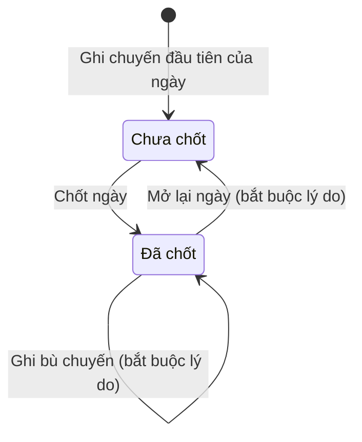
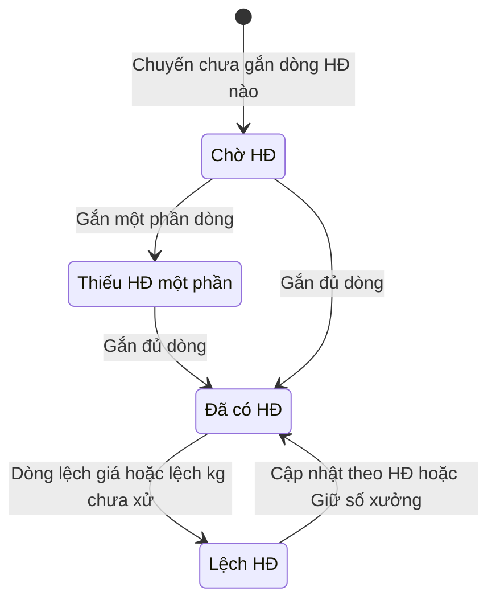
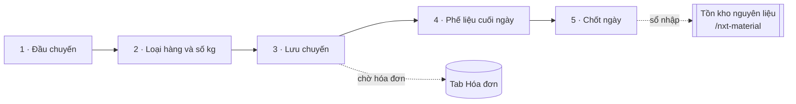
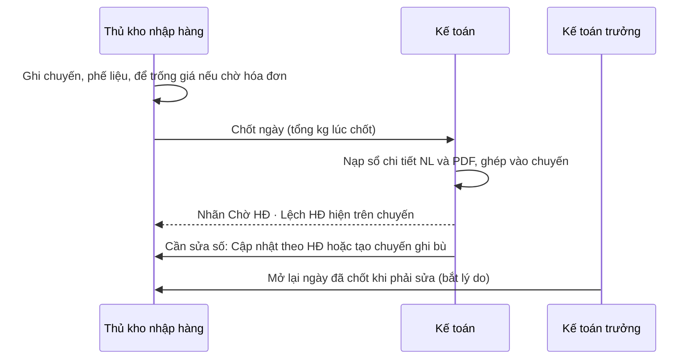

# Nhập hàng — sơ đồ workflow

> Load khi: review / kiểm lại trang Nhập hàng (`/imports`) và Tồn kho nguyên liệu (`/nxt-material`), trước khi sửa luật chuyến, ghi bù, chốt ngày, phế liệu, hóa đơn đại lý. Bản đọc nhanh — luật đầy đủ ở [30-nhap-hang](../app-map/30-nhap-hang.md) · ba-spec [51](../app-map/51-supplier-invoice-matching.ba-spec.md) · [36](../app-map/36-so-kho-thang.md) (tồn theo tháng).
covers: src/features/imports/*, src/features/reports/MaterialNxtScreen.tsx, src/lib/supplierInvoice*.ts, src/lib/inventoryMaterial.ts, src/lib/periodUtils.ts
tours: src/features/imports/importsTour.ts, src/features/reports/materialStockTour.ts
guides: src/features/shared/guideContent.tsx, src/features/shared/guides/materialStockGuide.tsx
last_verified: 2026-11-06
ttl_days: 90

Sửa code trong `covers:` mà không sửa file này ⇒ commit bị chặn ([README](README.md) § Luật đồng bộ).

## 1. Một ngày nhập và một chuyến đi qua những trạng thái nào

Sổ chốt theo cặp **ngày × phân xưởng** (`/imports`, khối "Cuối ngày"). Chuyến không có trạng thái riêng. Chuyến chỉ mang nhãn **Ghi bù** khi ngày ghi sổ sau ngày hàng về (`isBackdatedImport`).

| Trạng thái | Nghĩa | Sang bước sau khi | Ai làm | Code |
|---|---|---|---|---|
| Chưa chốt | Ngày còn sửa, xóa, thêm chuyến và phế liệu | Bấm **Chốt ngày**. Còn dòng hợp lệ chưa lưu ⇒ hộp nhắc lưu trước. Phế liệu đang gõ được lưu cùng lúc | Thủ kho nhập hàng · Kế toán (quyền Chốt) | `lockDay` · `DailyLock.isLocked` |
| Đã chốt | Khóa chuyến thường và khối phế liệu. Lưu `totalKgAtLock` lúc chốt | **Mở lại ngày** (bắt buộc lý do, lưu vết, không xóa bản ghi). Hoặc ghi bù chuyến có lý do, khi đó hiện "Còn ghi bù ±N kg sau chốt" | Kế toán trưởng (quyền Mở lại) | `reopenDay` · `validateShipmentHeader` |

Ghi chú:
- Bản ghi chốt có id cố định `<ngày>|<xưởng>` nên hai máy cùng chốt không đụng nhau.
- Sổ chốt còn đang nạp ⇒ từ chối chốt, báo "đợi vài giây".
- Chuyến tạo từ hóa đơn luôn là chuyến ghi bù, lý do điền sẵn "Theo HĐ ‹số›".

### Trạng thái hóa đơn của chuyến (tab Hóa đơn, ba-spec 51 R11)

Tính tự động, không gõ tay. Chỉ xét dòng chuyến có loại NL đã ánh xạ mã kế toán (R8).

| Nhãn dòng HĐ | Nghĩa | Cách xử |
|---|---|---|
| Khớp | Cùng kg và đơn giá với chuyến | Không cần |
| Lệch giá · Lệch kg | Số hóa đơn khác số chuyến | **Cập nhật theo HĐ** (sửa số chuyến, để dòng vết) ⇒ Đã cập nhật theo HĐ. Hoặc **Giữ số xưởng** (bắt lý do) ⇒ Lệch đã giải trình |
| Không có chuyến | Dòng HĐ chưa có chuyến để ghép | **Tạo chuyến từ HĐ** (chuyến ghi bù) |
| Không thuộc chuyến | Kế toán xếp HĐ ra ngoài sổ nhập | Bấm bỏ xếp để ghép lại |
| Chưa ánh xạ | Mã đại lý hoặc mã vật tư chưa có trong danh mục | Ánh xạ mã kế toán trước |

**Gỡ hóa đơn gắn nhầm** (ba-spec 51 NV7 · R17): **Chi tiết** ở dòng đầu hóa đơn → **Gỡ hóa đơn** trong hộp chi tiết (không có nút trên dòng bảng). Cần quyền Xóa `imports.invoices` (Kế toán trưởng). Hỏi xác nhận, có Hoàn tác, ghi nhật ký ở hồ sơ hóa đơn và hồ sơ ngày × xưởng của chuyến đang gắn.

| Trường hợp | Kết quả | Code |
|---|---|---|
| HĐ chưa tạo chuyến ghi bù | Bỏ HĐ + mọi dòng sổ chi tiết + thông tin file. Sổ Nhập hàng không đổi, chuyến đang gắn về **Chờ HĐ** | `planInvoiceRemoval` |
| HĐ đã **Tạo chuyến từ HĐ**, chuyến còn trong sổ | **Chặn**, báo xóa chuyến đó trước (mở chuyến → Xóa chuyến) | `tripsCreatedFromInvoice` |
| Dòng chuyến đã **Cập nhật theo HĐ** | Gỡ vẫn được, số chuyến **giữ số mới**. Hộp chi tiết báo trước; số cũ ở vết "[Sửa theo HĐ …]" | `updatedTripLineIds` |

File PDF trên kho file giữ nguyên để Hoàn tác được; nạp lại đúng file thì gắn lại.

Nạp lại file không nhân đôi dòng. Mỗi dòng so với lần nạp trước: Mới · Đổi · Như cũ · Không còn trong file (R9). PDF kiểm chéo với sổ kế toán, cảnh báo: PDF chưa có trong sổ kế toán · MST danh mục khác hóa đơn · PDF lệch sổ kế toán · Nhiều HĐ cùng số — chưa biết của đại lý nào. Code: `tripInvoiceInfo` · `lineStateNow` · `isOpenMismatch` · `TRIP_INVOICE_STATUS_LABELS` · `SUPPLIER_INVOICE_LINE_STATE_LABELS` · `IMPORT_CHANGE_LABELS` · `PDF_WARNING_LABELS`.

## 2. Các bước ghi một ngày nhập

| Bước | Mục | Xong khi | Ai làm |
|---|---|---|---|
| 1 · Đầu chuyến | Ngày hàng về · Phân xưởng · Đại lý giao hàng · Tài xế · Biển số | `validateShipmentHeader` không còn lỗi: có đại lý; ngày ghi sổ không trước ngày hàng về; ghi bù hoặc ngày đã chốt thì phải có **Lý do ghi bù** | Thủ kho nhập hàng |
| 2 · Loại hàng và số kg | Bảng Loài · Loại NL · Số lượng · Đơn giá | Có ít nhất một dòng có loại và kg > 0. Dòng điền sẵn mà chưa gõ kg bị bỏ qua (`isSuggested`). Đơn giá được để trống ⇒ nhãn "Chưa có giá" | Thủ kho nhập hàng |
| 3 · Lưu chuyến | Nút "Lưu chuyến vào sổ" / "Lưu thay đổi chuyến" | `saveSession` ghi chuyến và mọi dòng hợp lệ một lần. Chuyến chỉ được tạo khi có dòng hàng đầu tiên | Thủ kho nhập hàng |
| 4 · Phế liệu cuối ngày | Nội tạng · Dạt · Loại khác, nút "Lưu phế liệu" | Có kg thì ghi, xóa kg thì bỏ khỏi sổ. Dòng ghi với `nguon = "Nhập hàng"`. Ngày đã chốt thì khóa | Thủ kho nhập hàng |
| 5 · Chốt ngày | Nút "Chốt ngày" (chỉ hiện khi xem MỘT ngày của MỘT xưởng) | Có bản ghi `isLocked = true` và `totalKgAtLock` = tổng thật của ngày (`dayWorkshopTotal`, không theo bộ lọc) | Thủ kho nhập hàng · Kế toán |
| Sau đó · Hóa đơn | Nạp sổ chi tiết NL, PDF; ghép, xử lệch | Chuyến đạt "Đã có HĐ" (xem § 1) | Kế toán (quyền `imports.invoices`) |

**Ảnh phiếu tay** (nhãn "Đã đính ảnh phiếu" ở Đầu chuyến, đính khi Đọc ảnh phiếu): **Xem** · **Thay ảnh** (chọn ảnh khác, không đọc lại số, có Hoàn tác) · **Gỡ ảnh** (hỏi xác nhận, có Hoàn tác). Đổi ảnh là sửa phiếu, chỉ vào sổ khi Lưu chuyến (nhật ký ghi "· gỡ / thay ảnh phiếu"). Chuyến của ngày đã chốt ⇒ Mở lại ngày trước. File ảnh trên kho giữ nguyên.

Phiếu "Báo cáo ngày" (in A4 ngang) và tab "Báo cáo" chỉ đọc, không đổi dữ liệu. Tab "Hóa đơn" chỉ hiện khi có quyền Xem `imports.invoices`.

## 3. Bàn giao giữa bộ phận

- Xưởng chỉ thấy nhãn trạng thái HĐ trên chuyến. File PDF và tiền hóa đơn chỉ người có quyền `imports.invoices` thấy (R12).
- Không tự đổi số chuyến theo HĐ (R6): chỉ đổi khi kế toán chọn Cập nhật theo HĐ. Xóa chuyến, hoặc bỏ dòng khi sửa chuyến ⇒ dòng HĐ về "Không có chuyến", bỏ quyết định cũ (R14, `unlinkRemovedTripLines`). Người xóa không có quyền ghi hóa đơn ⇒ tab Hóa đơn vẫn hiện "Không có chuyến", lần nạp lại ghép mới. Hoàn tác xóa chuyến ⇒ liên kết trở lại.

## 4. Tồn kho nguyên liệu (`/nxt-material`)

Sổ **chỉ đọc**, tính ra từ sổ nhập. Ô nhập tay duy nhất là **Tồn đầu kho nguyên liệu** (hộp thoại, khai theo xưởng · loại NL · ngày bắt đầu · khối lượng). Hàm: `computeMaterialTotalStock`.

- Tồn cuối = Tồn đầu + Nhập − Xuất SX − Bán nội địa, theo ngày, cả ba phân xưởng.
- Xuất SX chưa được ghi nên tạm bằng 0. Tồn hiện là tồn theo nhập, chưa trừ phần đưa vào chế biến.
- Cột "Đông gửi / Xả đông" chỉ là thông tin của vòng gối đầu, không cộng vào tồn.
- Còn dở sản xuất ghi ở ngày không có kỳ cân đối phủ ⇒ hiện cảnh báo, không để số biến mất.

## 5. Ai được làm gì

Sinh từ ma trận quyền mặc định (vai đã chỉnh ở /roles có thể khác). Admin luôn đủ quyền.

<!-- gen:roles — sinh tự động từ src/lib/permissions.ts, đừng sửa tay -->
**Nhập hàng** (`imports`)

| Vai | Xem | Thêm | Sửa | Xóa | Chốt | Mở lại | Xuất / In | Xem giá |
|---|---|---|---|---|---|---|---|---|
| Giám đốc | ✓ |  |  |  |  |  | ✓ | ✓ |
| Phó giám đốc | ✓ |  |  |  |  |  | ✓ | ✓ |
| Thủ kho nhập hàng | ✓ | ✓ | ✓ | ✓ | ✓ |  | ✓ | ✓ |
| Kế toán trưởng | ✓ |  | ✓ | ✓ | ✓ | ✓ | ✓ | ✓ |
| Kế toán | ✓ | ✓ | ✓ |  | ✓ |  | ✓ | ✓ |

**Nhập hàng · Hóa đơn đại lý** (`imports.invoices`)

| Vai | Xem | Thêm | Sửa | Xóa |
|---|---|---|---|---|
| Giám đốc | ✓ |  |  |  |
| Phó giám đốc | ✓ |  |  |  |
| Kế toán trưởng | ✓ | ✓ | ✓ | ✓ |
| Kế toán | ✓ | ✓ | ✓ |  |

**Tồn kho nguyên liệu** (`nxt-material`)

| Vai | Xem | Thêm | Sửa | Xóa | Xuất / In |
|---|---|---|---|---|---|
| Giám đốc | ✓ |  |  |  | ✓ |
| Phó giám đốc | ✓ |  |  |  | ✓ |
| Quản đốc xưởng Đông | ✓ |  |  |  |  |
| Quản đốc xưởng Cá | ✓ |  |  |  |  |
| Quản đốc xưởng Khô | ✓ |  |  |  |  |
| Thủ kho nhập hàng | ✓ |  |  |  |  |
| Kế toán trưởng | ✓ | ✓ | ✓ | ✓ | ✓ |
| Kế toán | ✓ | ✓ | ✓ |  | ✓ |
<!-- /gen:roles -->

## 6. Nối với module khác

| Sang | Khi nào | Luật |
|---|---|---|
| Cân đối (`/balancing`) | Kỳ tự lấy chuyến cùng họ NL trong khoảng ngày. Phế liệu `nguon = "Nhập hàng"` chỉ đọc ở đó | [31](../app-map/31-can-doi-ky.md) |
| Sản xuất (`/wip`) | Lô NL = một dòng loại hàng của chuyến, mã `S:<id>`; gắn lô NL ở phiên sản xuất | spec qr-truy-xuat-lo §6e |
| Kho (`/qr`) | Nút Tem ở cột ngày in mỗi loại một tem | [warehouse.md](warehouse.md) |
| Tổng quan | Việc theo hóa đơn đại lý mở thẳng tab Hóa đơn (`/imports?tab=invoices`) | ba-spec 55 |

## Lịch sử

- 2026-11-06 — gỡ hóa đơn gắn nhầm (hộp Chi tiết), gỡ / thay ảnh phiếu, xóa dòng chuyến bỏ liên kết HĐ ngay.
- 2026-11-03 — tạo.
