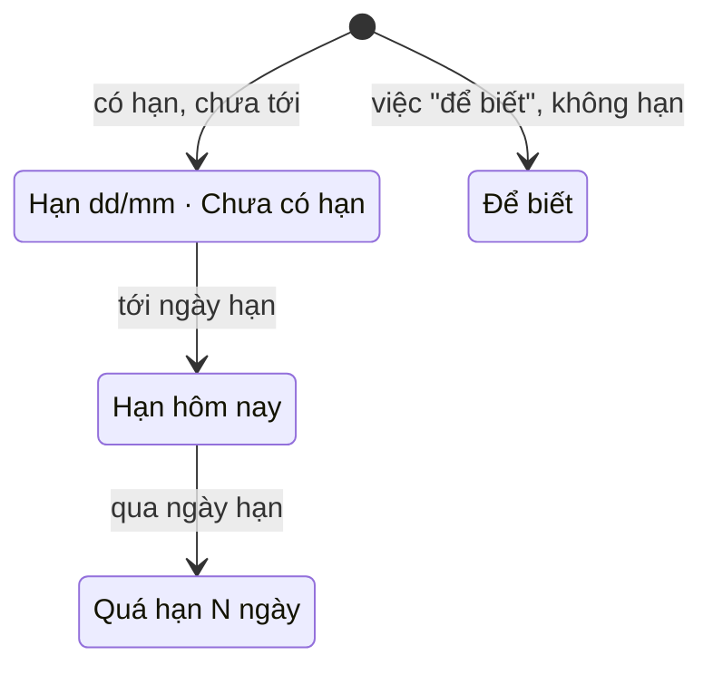
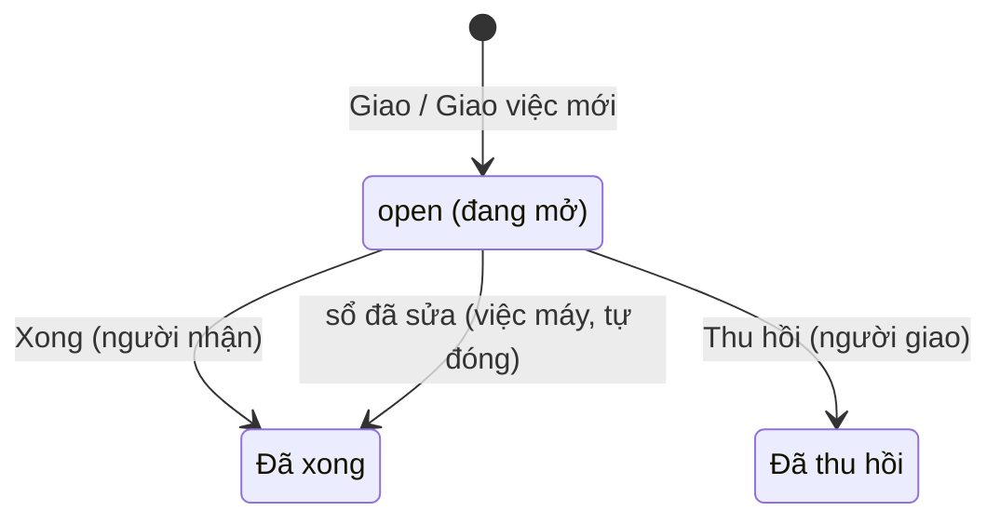
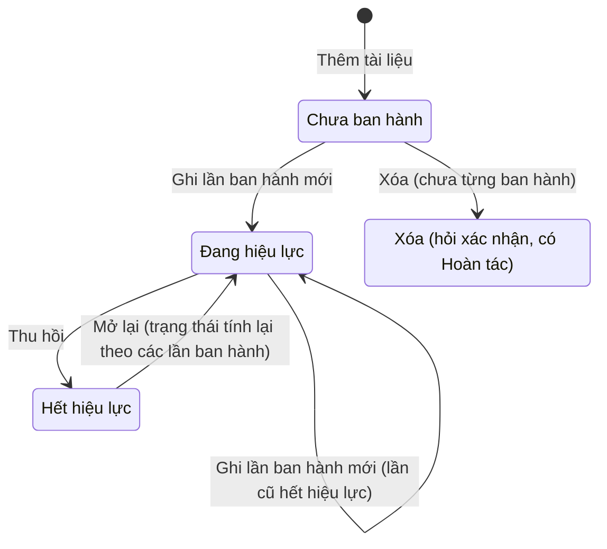
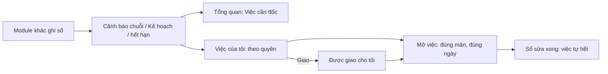
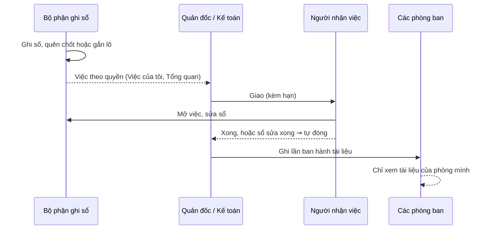

# Việc của tôi · Tổng quan · Tài liệu — sơ đồ workflow

> Load khi: review / kiểm lại ba trang `/my-tasks` (Việc của tôi), `/dashboard` (Tổng quan), `/documents` (Tài liệu công ty); trước khi sửa luật hạn việc, giao việc, cảnh báo chuỗi, lần ban hành, xem tài liệu theo phòng ban. Bản đọc nhanh — luật đầy đủ ở [39-my-tasks](../app-map/39-my-tasks.md) · [59](../app-map/59-my-tasks-by-role.ba-spec.md) · [40-documents](../app-map/40-documents.md) · [55](../app-map/55-dashboard-modules.ba-spec.md) · spec che-do-demo §5b.
covers: src/features/my-tasks/*, src/features/dashboard/*, src/features/documents/*, src/lib/myTasks.ts, src/lib/dataFlow.ts, src/lib/dashboardAttention.ts, src/lib/documents.ts, src/lib/documentStorage.ts
last_verified: 2026-11-03
ttl_days: 90

Sửa code trong `covers:` mà không sửa file này ⇒ commit bị chặn ([README](README.md) § Luật đồng bộ). Cả ba trang là màn xem / điều phối: số liệu do module khác ghi, ở đây chỉ đọc (trừ giao việc và tài liệu).

## 1. Các đối tượng và trạng thái

Không có một máy trạng thái chung. Có ba loại bản ghi: **việc** (hạn), **dòng giao việc** (`task_assignments`), **tài liệu**.

### 1a. Hạn của một việc (Việc của tôi)

| Trạng thái | Nghĩa | Sang bước sau khi | Ai làm | Code |
|---|---|---|---|---|
| Hạn dd/mm · Chưa có hạn | Việc cần làm, hạn còn xa hoặc chưa đặt hạn | Qua thời gian; hoặc sổ được sửa thì việc biến mất | Người có quyền làm việc đó | `urgencyOf` · `defaultDueDate` |
| Hạn hôm nay | Đúng ngày hạn | Qua ngày hạn mà chưa xong | | `urgencyOf` |
| Quá hạn N ngày | Hôm nay đã qua ngày hạn | Sổ sửa xong thì tự hết | | `urgencyOf` |
| Để biết | Không có hạn, không đếm quá hạn (Ghi bù, Định mức lệch…) | — | | `DUE_OFFSET_DAYS` = `null` |

Hạn = ngày của việc + `DUE_OFFSET_DAYS[loại]`. Việc đếm từ `TASKS_START_DATE` (2026-09-01). Bộ lọc "Lọc theo hạn": **Cần làm** (mặc định) · **Quá hạn** · **Hôm nay** · **Để biết** · **Tất cả**.

### 1b. Dòng giao việc

| Trạng thái | Nghĩa | Sang bước sau khi | Ai làm | Code |
|---|---|---|---|---|
| `open` (đang mở — tên trong code, app không có nhãn riêng) | Đã giao cho một người, có hạn. Người khác không thấy ở "Việc theo quyền" | Người nhận bấm **Xong**; hoặc việc máy được sửa xong ở sổ | Người có quyền giao (`my-tasks` Thêm) | `buildMyTasks` · `findResolvedAssignments` |
| Đã xong | Hiện ở "Tôi đã giao" thêm `DONE_VISIBLE_DAYS` (7) ngày | — | Người nhận | `TaskAssignment.status` |
| Đã thu hồi | Việc máy quay về danh sách chung theo quyền | — (hỏi trước, có Hoàn tác) | Người giao | `TaskAssignment.status` |

Màn tự đóng việc máy chỉ khi mọi sổ đã nạp xong từ máy chủ (tránh đóng nhầm khi sổ còn trống).

### 1c. Tài liệu

| Trạng thái | Nghĩa | Sang bước sau khi | Ai làm | Code |
|---|---|---|---|---|
| Chưa ban hành | Tài liệu vừa thêm, chưa có lần ban hành nào | Ghi một lần ban hành đã ký giấy (có hiệu lực ngay). Xóa chỉ được ở trạng thái này | Người có quyền ghi tài liệu | `documentState` · `canDeleteDocument` |
| Dự thảo | Có lần ban hành nhưng chưa lần nào đang hiệu lực | Ghi lần ban hành mới | Người có quyền ghi | `DOCUMENT_STATE_LABELS` |
| Đang hiệu lực | Có một lần `active` | Ghi lần mới ⇒ lần cũ chuyển Hết hiệu lực từ ngày hiệu lực mới, không ghi đè | Người có quyền ghi | `recordPaperVersion` |
| Hết hiệu lực | Tài liệu đã thu hồi; mọi lần ban hành và file giữ nguyên, mở lại được | **Mở lại** | Người có quyền ghi | `documentState` |

- Lần ban hành còn thiếu file: **Đính PDF đã ký** / **Đính file gốc**, chỉ điền ô đang trống, không thay file đã có (`attachVersionFile`).
- Chứng nhận / hồ sơ năng lực có hạn: còn ≤ `DOCUMENT_EXPIRY_NOTICE_DAYS` (60) ngày hoặc đã hết ⇒ thành việc "Tài liệu sắp hết hạn", hạn việc = ngày hết hạn (`buildDocumentWarnings`, `expiryOf`).

## 2. Các bước của luồng

| Bước | Mục | Xong khi | Ai làm |
|---|---|---|---|
| 1 · Phát hiện | `buildChainWarnings` (chuỗi xưởng), `buildDocumentWarnings`, báo cáo Kế hoạch (`dashboardAttention.ts`) | Máy tự tính, không ai bấm | Máy |
| 2 · Xem tổng | Tổng quan: 4 thẻ, **Năm khâu của chuỗi**, **Phòng Kế hoạch**, **Việc cần đốc**; lọc kỳ + phân xưởng | Chỉ xem, không ghi | Người có quyền `dashboard` |
| 3 · Nhận việc | Việc của tôi: **Được giao cho tôi**, **Việc theo quyền của tôi** (quyền + phạm vi dòng, `canDoTask`), **Tôi đã giao** | Việc đã giao cho A thì B không thấy ở "theo quyền" (khỏi làm trùng) | Mọi người có vai trò |
| 4 · Giao việc | Nút **Giao** (việc máy) hoặc **Giao việc mới** (việc tay: tiêu đề, người nhận, hạn, màn cần mở) | Có dòng `task_assignments` còn mở | Người có `my-tasks` Thêm |
| 5 · Làm | **Mở việc** ⇒ mở đúng màn + ngày (`?date=&workshop=`); việc tay: **Xong** | Việc máy: sổ sửa xong. Việc tay: người nhận bấm Xong | Người nhận |
| 6 · Tài liệu | **Thêm tài liệu** ⇒ **Ghi lần ban hành mới** ⇒ đính PDF đã ký | Tài liệu Đang hiệu lực, có PDF (thẻ "Thiếu file PDF" hết đếm) | Người có quyền ghi tài liệu |

Việc Kế hoạch trong Việc của tôi (hạn theo `DUE_OFFSET_DAYS`, ba-spec 59). Nhãn gốc ở `PLANNING_ATTENTION_LABELS`:

| Module | Loại việc |
|---|---|
| Xuất khẩu | Quá hạn giao · Vượt dung sai · Thiếu dung sai · Còn tiền chưa về · Hồ sơ HĐ bổ sung sau |
| Nhập khẩu | Thiếu chứng từ · Chờ thực nhập |
| Lệnh sản xuất | Nháp quá ngày SX · Theo bản HĐ trước · Chưa gắn chuyến |
| Hóa đơn đại lý | Chuyến chờ HĐ đại lý · Chuyến lệch HĐ đại lý |

## 3. Chỗ bàn giao giữa bộ phận

- Xem tài liệu: admin, Ban giám đốc (`SEE_ALL_DEPARTMENT`) hoặc chạy không đăng nhập thấy hết; người khác thấy tài liệu "cả công ty", của phòng mình, hoặc phòng được chọn (`canViewDocument`). Phòng ban của người = hợp phòng các vai trò (`departmentsOfRoles`).
- Ba lớp chặn đọc tài liệu: app, RLS, bucket `documents`. Đổi bảng phòng ban ở code ⇒ viết migration mới cho `current_user_departments()`.

## 5. Ai được làm gì

Sinh từ ma trận quyền mặc định (vai đã chỉnh ở /roles có thể khác). Admin luôn đủ quyền. `my-tasks` và `documents`: Xem do hệ thống tự cấp cho ai đã có quyền ở đâu đó (`resolvePermissions`).

<!-- gen:roles — sinh tự động từ src/lib/permissions.ts, đừng sửa tay -->
**Tổng quan** (`dashboard`)

| Vai | Xem | Xuất / In |
|---|---|---|
| Giám đốc | ✓ | ✓ |
| Phó giám đốc | ✓ | ✓ |
| Quản đốc xưởng Đông | ✓ |  |
| Quản đốc xưởng Cá | ✓ |  |
| Quản đốc xưởng Khô | ✓ |  |
| Phó quản đốc | ✓ |  |
| Kế toán trưởng | ✓ | ✓ |
| Kế toán | ✓ | ✓ |

**Việc của tôi** (`my-tasks`)

| Vai | Xem | Thêm | Sửa | Xóa |
|---|---|---|---|---|
| Quản đốc xưởng Đông | ✓ | ✓ | ✓ | ✓ |
| Quản đốc xưởng Cá | ✓ | ✓ | ✓ | ✓ |
| Quản đốc xưởng Khô | ✓ | ✓ | ✓ | ✓ |
| Phó quản đốc | ✓ | ✓ | ✓ |  |
| Kế toán trưởng | ✓ | ✓ | ✓ | ✓ |
| Kế toán | ✓ | ✓ | ✓ |  |
| Nhân viên Kế hoạch | ✓ | ✓ | ✓ | ✓ |
| Trưởng phòng Kế hoạch | ✓ | ✓ | ✓ | ✓ |
| Phó phòng Kế hoạch | ✓ | ✓ | ✓ | ✓ |

**Tài liệu công ty** (`documents`)

| Vai | Xem | Thêm | Sửa | Xóa | Duyệt | Xuất / In |
|---|---|---|---|---|---|---|
| Kế toán trưởng | ✓ | ✓ | ✓ | ✓ |  | ✓ |
<!-- /gen:roles -->

## 6. Nối với module khác

| Sang | Khi nào | Luật |
|---|---|---|
| Nhập hàng · Sản xuất · Kho · Cân đối | Việc chuỗi: chốt ngày nhập / SX, gắn lô, duyệt BTP, chốt kỳ, bán vượt tồn | ba-spec 39 · `taskRequirements` |
| Xuất khẩu · Nhập khẩu · Lệnh sản xuất | Việc Kế hoạch và khối Phòng Kế hoạch ở Tổng quan | ba-spec 55 · 59 |
| Danh mục · Quản trị | Phòng ban của vai trò (`app_roles.department`) quyết định xem tài liệu | ba-spec 40 |
| Chế độ demo | Tổng quan đọc dữ liệu demo khi admin bật; không số mẫu cứng | spec che-do-demo §5b |

## Lịch sử

- 2026-11-03 — tạo.
