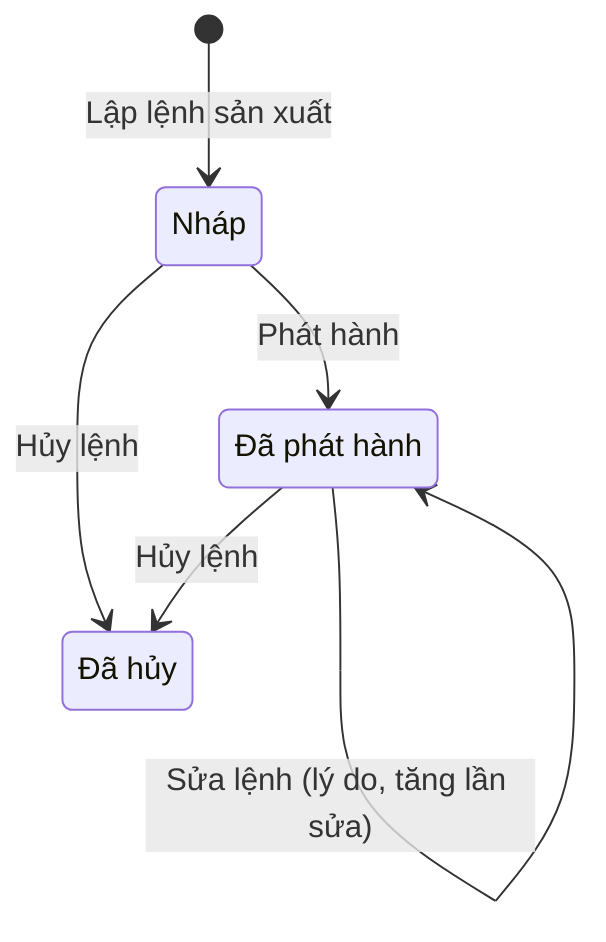
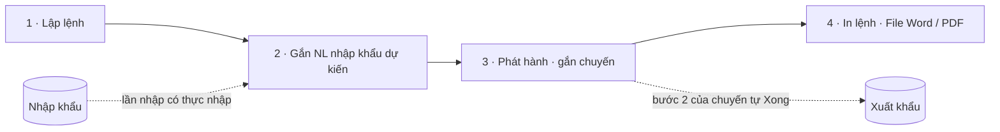
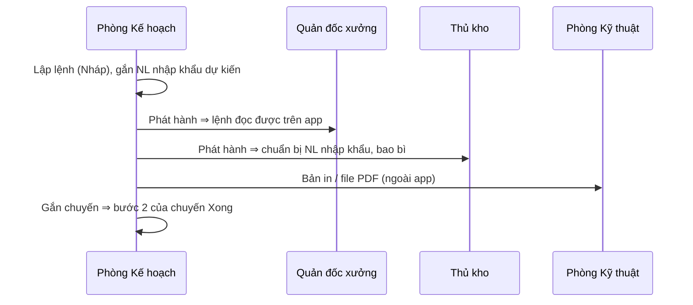

# Lệnh sản xuất — sơ đồ workflow

> Load khi: review / kiểm lại trang Lệnh sản xuất (`/planning-production`), trước khi sửa luật lập lệnh, phát hành, gắn chuyến, NL nhập khẩu dự kiến, file Word / PDF. Bản đọc nhanh — luật đầy đủ ở ba-spec [48](../app-map/48-production-order.ba-spec.md) · [54](../app-map/54-document-composer.ba-spec.md) · design-spec [49](../app-map/49-production-order-ui.design-spec.md).
covers: src/features/production-orders/*, src/lib/productionOrder.ts, src/lib/productionOrderFile.ts, src/lib/productionOrderReports.ts, src/lib/documentComposer.ts, src/lib/documentTypes/productionOrder*.ts
tours: src/features/production-orders/productionOrderTour.ts
guides: src/features/shared/guides/productionOrderGuide.tsx
last_verified: 2026-11-06
<!-- re-verified: 2026-11-06 (HĐ 23.26) — ngày ISO ở Ghi chú dòng của lệnh ⇒ Lệnh xuất in ngày SX theo dòng; file LSX đính ở chuyến mà chưa lập lệnh ⇒ Lệnh xuất đọc thẳng file (ba-spec 72 R2c, `orderFromFile`). Không đổi luật lệnh. -->
<!-- re-verified: 2026-11-06 (Phòng KH, HĐ 23.26 SEACHEMOT) — Lập lệnh: Đọc file lệnh sản xuất điền sẵn hộp (R21); Ghi chú dòng sửa được trên lệnh. Không đổi trạng thái, không đổi quyền. -->
<!-- re-verified: 2026-11-06 (audit "làm nhầm phải gỡ được") — bỏ gắn lệnh ngay ở chuyến xuất: bước 2 của chuyến → Gắn / bỏ gắn lệnh → Bỏ gắn, mọi trạng thái lệnh kể cả Đã hủy (`unlinkShipmentOrder`); có Hoàn tác, nhật ký HĐ + nhật ký lệnh. -->
<!-- re-verified: 2026-11-06 (ba-spec 74 R14) — chuyến nhiều HĐ: bước 2 của chuyến Xong khi MỌI HĐ trên chuyến có lệnh đã phát hành gắn chuyến (`issuedOrderContracts`); gộp chuyến chuyển lệnh gắn sang chuyến giữ. -->
<!-- re-verified: 2026-11-04 (chần / luộc) — Quy cách dòng lệnh thêm "Chần / luộc …" từ ô Thời gian chần / luộc của dòng HĐ (`contractLineSpec`). -->
<!-- re-verified: 2026-11-04 (chuyến gộp) — gắn chuyến: mọi chuyến có hàng của HĐ (cả chuyến gộp). Lệnh xuất lấy dòng lệnh theo HĐ + số lượng theo chuyến (ba-spec 72 R2b, R3b). Quyền: vai đã chỉnh cần mig 0105. -->
<!-- re-verified: 2026-11-04 — nhãn "Kg (tự tính)" của dòng lệnh đổi thành "Kg tịnh (tự tính)" (ô gõ tay: "Kg tịnh") cho khỏi nhầm với kg cả bì; không đổi luật, không đổi quyền. -->
ttl_days: 90

Sửa code trong `covers:` mà không sửa file này ⇒ commit bị chặn ([README](README.md) § Luật đồng bộ).

## 1. Một lệnh đi qua những trạng thái nào

| Trạng thái | Nghĩa | Sang bước sau khi | Ai làm | Code |
|---|---|---|---|---|
| Nháp | Vừa lập. Chỉ Phòng Kế hoạch thấy. Sửa thẳng, không tăng lần sửa | Bấm **Phát hành** (không qua duyệt). Lúc lập phải qua `validateOrder` | Nhân viên / Trưởng / Phó phòng Kế hoạch | `ORDER_STATUS_LABELS` · `issueOrder` |
| Đã phát hành | Quản đốc, thủ kho đọc được trên app; Phòng Kỹ thuật nhận bản in | Sửa: bắt **lý do**, lần sửa +1, hiện **Đã sửa lần n**. Hoặc hủy | Phòng Kế hoạch | `reviseOrder` · `visibleOrders` |
| Đã hủy | Bỏ lệnh. Chuyến gắn kèm và NL đã dành được nhả. Không xóa cứng | — | Phòng Kế hoạch (bắt lý do hủy) | `cancelOrder` |

Cờ đi kèm lệnh **Đã phát hành**: **Theo bản HĐ trước** (`STALE_REVISION_LABEL`). HĐ có bản hiệu lực mới sau khi phát hành thì lệnh giữ dòng cũ và hiện cờ. Cờ hết khi:
- bấm **Sửa theo bản mới** rồi lưu, hoặc
- bấm **Giữ nguyên theo bản cũ** kèm lý do (`keepOldRevision`). Cờ chỉ hiện lại khi HĐ có bản mới nữa (`staleRevision`).

Người chỉ có quyền Xem chỉ thấy lệnh đã từng phát hành (`visibleOrders`).

## 2. Các bước của luồng

| Bước | Mục | Xong khi | Ai làm |
|---|---|---|---|
| 1 · Lập lệnh | Hộp **Lập lệnh sản xuất** | `canCreateOrder` cho qua: HĐ chưa hủy, chưa đóng, có bản hiệu lực, dòng chọn đã nối mặt hàng. `validateOrder` hết lỗi: có số lệnh (không trùng), HĐ, ≥ 1 ngày sản xuất, ngày giao ≥ ngày sản xuất cuối, ≥ 1 dòng có số thùng (hoặc kiện) và kg > 0. Lưu xong ở **Nháp**. **Đọc file lệnh** (2026-11-06, ba-spec 48 R21): file Word / PDF có chữ — đã đính ở bước 2 của chuyến hoặc chọn trên máy — điền sẵn số lệnh, ngày lệnh, MSL, ngày sản xuất (ngày ISO trên thùng), ngày giao, thị trường, HSD, quy trình, lưu ý và dòng hàng (khớp dòng HĐ theo tên danh mục + size + quy cách đóng gói; số thùng / kiện theo file; quy cách đóng gói của file ⇒ Ghi chú dòng, sửa được). Ô đã gõ khác file thì giữ + kê; cảnh báo: dòng không khớp HĐ, vượt phần HĐ còn lại, kg file ≠ kg tính theo HĐ, khách khác HĐ, số lệnh trùng, ngày ISO trước ngày lệnh. Không tự lưu (`parseOrderRows` · `matchOrderLines` · `fillOrderForm`) | Phòng Kế hoạch |
| 2 · NL nhập khẩu dự kiến | **Gắn NL nhập khẩu** / **Sửa NL dự kiến** | Chọn lần nhập có thực nhập, chưa hủy (`materialOptions`) và gõ kg. Dành vượt thực nhập: cảnh báo, vẫn lưu. Không ghi sổ kho (`reservationOf`) | Phòng Kế hoạch |
| 3 · Phát hành · gắn chuyến | **Phát hành** → **Gắn chuyến** | Chuyến chọn được: chuyến còn mở **có hàng của HĐ** của lệnh, kể cả chuyến gộp của HĐ khác (`openShipmentsOf`, ba-spec 70). Lệnh sang Đã phát hành. Mỗi chuyến gắn: bước **Lệnh sản xuất** của chuyến Xong (`issuedShipmentIds`) — chuyến nhiều HĐ: Xong khi mọi HĐ trên chuyến có lệnh gắn (`issuedOrderContracts`, ba-spec 74 R14); chuyến chưa có mã số lô nhận mã của lệnh (`shipmentsWithLot`) | Phòng Kế hoạch |
| 3b · Bỏ gắn chuyến (gắn nhầm) | Trang lệnh: **Gắn chuyến** bỏ tick (lệnh còn hiệu lực). Ngay ở chuyến xuất (bước 2): **Gắn / bỏ gắn lệnh** → mục Đang gắn → **Bỏ gắn** — mọi trạng thái lệnh, cả **Đã hủy** (link cũ không tính cho bước nhưng vẫn gỡ được). Hỏi lại, có Hoàn tác; nhật ký HĐ + nhật ký lệnh ghi "Bỏ gắn"; MSL chuyến đã nhận giữ nguyên | Gỡ link xong | Phòng Kế hoạch (`production-orders` Sửa) — `unlinkShipmentOrder` |
| 4 · In · file | **In lệnh** · **File Word / PDF** | In A4 mẫu QTI-KH-01-04, không in giá. File soạn có trạng thái ở bảng dưới | Phòng Kế hoạch soạn; nơi nhận chỉ xem |

Quy ước tính trong lệnh:
- kg dòng = thùng × kg tịnh mỗi thùng; dòng đếm kiện thì thùng = kiện × thùng/kiện (`lineKg` · `lineCartons`).
- Hạn sử dụng = tháng của ngày sản xuất sớm nhất + N tháng, về ngày 01; mặc định 24 tháng (`expiryDate` · `DEFAULT_SHELF_LIFE_MONTHS`).
- "Còn chưa ra lệnh" của dòng HĐ = kg HĐ − tổng kg các lệnh chưa hủy; vượt dung sai thì cảnh báo (`contractLineCoverage`).
- Trùng mã số lô với lệnh khác đang phát hành: cảnh báo, vẫn lưu.

### File Word / PDF (ba-spec 54)

| Trạng thái | Nghĩa | Sang bước sau khi | Ai làm | Code |
|---|---|---|---|---|
| Nháp | Chưa xuất lần nào | Xuất Word hoặc PDF | Phòng Kế hoạch | `COMPOSED_STATUS_LABELS` · `composedStatus` |
| Đã xuất | Giá trị hiện tại trùng bản chụp lần xuất gần nhất | Sửa ô ⇒ Sửa sau lần xuất | Phòng Kế hoạch | `composedStatus` |
| Sửa sau lần xuất | Đã khác lần xuất gần nhất | Xuất lại ⇒ Đã xuất | Phòng Kế hoạch | `composedStatus` |

Lệnh sửa sau khi soạn ⇒ có cờ nguồn cũ (`isSourceStale`), dùng **Lấy lại số từ lệnh**.

## 3. Chỗ bàn giao giữa bộ phận

Nơi nhận không thấy đơn giá, tiền. Lệnh Nháp không hiện với họ.

## 4. Tab Báo cáo

Lệnh xếp vào tháng theo ngày sản xuất đầu tiên (`orderMonth`). Mục **Cần chú ý** (`ORDER_ATTENTION_LABELS`):

| Vấn đề | Khi nào |
|---|---|
| Nháp quá ngày SX | Lệnh còn Nháp mà ngày sản xuất đầu đã tới |
| Theo bản HĐ trước | Lệnh có cờ như mục 1 |
| Chưa gắn chuyến | Lệnh Đã phát hành mà chưa gắn chuyến nào |

Lệnh Đã hủy chỉ đếm, không cộng kg.

## 5. Ai được làm gì

Sinh từ ma trận quyền mặc định (vai đã chỉnh ở /roles có thể khác). Admin luôn đủ quyền.

<!-- gen:roles — sinh tự động từ src/lib/permissions.ts, đừng sửa tay -->
**Kế hoạch · Lệnh sản xuất** (`production-orders`)

| Vai | Xem | Thêm | Sửa | Xóa |
|---|---|---|---|---|
| Giám đốc | ✓ |  |  |  |
| Phó giám đốc | ✓ |  |  |  |
| Quản đốc xưởng Đông | ✓ |  |  |  |
| Quản đốc xưởng Cá | ✓ |  |  |  |
| Quản đốc xưởng Khô | ✓ |  |  |  |
| Phó quản đốc | ✓ |  |  |  |
| Thủ kho nhập hàng | ✓ |  |  |  |
| Kế toán trưởng | ✓ |  |  |  |
| Kế toán | ✓ |  |  |  |
| Nhân viên Kế hoạch | ✓ | ✓ | ✓ | ✓ |
| Trưởng phòng Kế hoạch | ✓ | ✓ | ✓ | ✓ |
| Phó phòng Kế hoạch | ✓ | ✓ | ✓ | ✓ |
<!-- /gen:roles -->

## 6. Nối với module khác

| Sang | Khi nào | Luật |
|---|---|---|
| Xuất khẩu (`/planning-export`) | Lập từ hồ sơ HĐ hoặc lúc lập HĐ (`?new=1&contract=…`); gắn chuyến làm bước 2 của chuyến Xong | ba-spec 48 R6 |
| Nhập khẩu (`/planning-import`) | Chọn lần nhập có thực nhập để dành NL; chỉ đọc, không ghi ngược | ba-spec 48 R5 |
| Sản xuất (`/wip`) | Tổ trưởng chưa ghi sản lượng theo lệnh (để đợt sau) | ba-spec 48 Q8 |
| Kho | Thủ kho đọc lệnh Đã phát hành để chuẩn bị NL, bao bì | ba-spec 48 R9 |

## Lịch sử

- 2026-11-03 — tạo.
