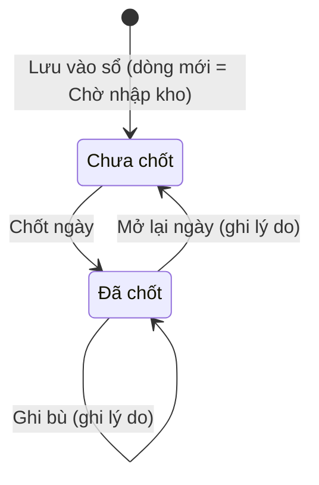
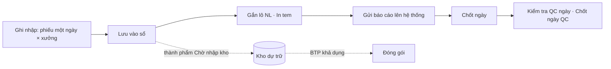
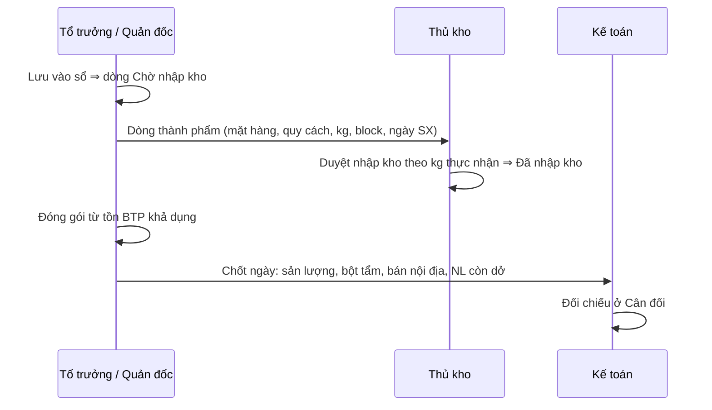

# Sản xuất — sơ đồ workflow

> Load khi: review / kiểm lại 3 trang Sản xuất thành phẩm (`/wip`), Đóng gói (`/packaging`), Kiểm tra QC (`/qc`); trước khi sửa luật chốt ngày, ghi bù, nhập kho, đóng gói. Bản đọc nhanh — luật đầy đủ ở ba-spec [34](../app-map/34-btp-san-xuat-kho.ba-spec.md) · design-spec [35](../app-map/35-btp-ui.design-spec.md).
covers: src/features/production/*, src/features/packaging/*, src/features/quality-check/*, src/lib/inventory.ts
last_verified: 2026-11-03
ttl_days: 90

Sửa code trong `covers:` mà không sửa file này ⇒ commit bị chặn ([README](README.md) § Luật đồng bộ).

## 1. Một ngày sản xuất đi qua những trạng thái nào

Đối tượng chính là **ngày × phân xưởng** (Đông · Cá · Khô). `/wip` và `/qc` có chốt ngày riêng, mỗi ngày × xưởng một bản ghi.

| Trạng thái | Nghĩa | Sang bước sau khi | Ai làm | Code |
|---|---|---|---|---|
| Chưa chốt | Sổ ngày × xưởng còn sửa, ghi thêm bình thường | Chốt ngày: mọi mẻ đã gắn lô NL, hoặc đã ghi **Lý do chưa gắn lô** cho mẻ còn thiếu (lý do lưu thành miễn trừ từng mẻ) | Người có quyền Khóa ở `wip` | `lockDay` · `findBatchesWithoutLot` |
| Đã chốt | Sổ ngày khóa. Ghi thêm sau chốt là **ghi bù**, bắt lý do. Thẻ "Còn ghi bù … kg sau chốt" khi tổng hiện tại khác tổng lúc chốt | **Mở lại ngày** kèm **Lý do mở lại** (lưu vết); sửa xong chốt lại | Người có quyền Mở khóa ở `wip` | `reopenDay` · `totalKgAtLock` |
| Chưa chốt (QC) | Bảng kiểm QC ngày × xưởng còn chấm, sửa | Chốt ngày: đã lưu ≥ 1 chỉ tiêu | Người có quyền Khóa ở `qc` | `lockDay` ở QcChecklistScreen |
| Đã chốt (QC) | Bảng kiểm khóa, không thêm ảnh; sửa kết quả phải ghi lý do ghi bù | **Mở lại ngày** | Người có quyền Mở khóa ở `qc` | `reopen` |

**Ghi bù** (cả `/wip` và `/qc`): ngày ghi sổ sau ngày sản xuất, hoặc ngày đã chốt ⇒ bắt **Lý do ghi bù**, thiếu thì không lưu. Ngày ghi sổ không được trước ngày sản xuất. Code: `isBackdatedWip` · `isBackdatedQc` (`src/types.ts`).

### Một dòng thành phẩm (Trạng thái ở sổ `/wip`)

| Trạng thái | Nghĩa | Sang bước sau khi | Ai làm | Code |
|---|---|---|---|---|
| Chờ nhập kho | Mới lưu vào sổ. Chưa tính vào tồn kho dự trữ | Thủ kho duyệt ở trang Kho dự trữ theo kg thực nhận | Thủ kho (module Kho) | `status === "pending"` |
| Đã nhập kho | Đã duyệt vào kho; hiện kèm tên kho. Tồn dự trữ đã cộng | — | Thủ kho | `status === "stocked"` |

Tồn kho chỉ cộng khi thủ kho duyệt, không tự cộng lúc chốt ngày (ba-spec 34 AC-2).

## 2. Các bước trong ngày

| Bước | Mục | Xong khi | Ai làm |
|---|---|---|---|
| 1 · Ghi nhập (`/wip`) | Thành phẩm · Bán nội địa · Hàng đông lạnh | Có ít nhất một dòng đủ **Thành phẩm** và **Số lượng (kg)** > 0 (`isLineComplete`); đủ ngày, lý do ghi bù nếu cần. Lưu vào sổ ghi một lượt cả ba loại | Tổ trưởng / quản đốc |
| 2 · Gắn lô NL | Lô NL của phiên · từng mẻ | Mẻ có lô NL, hoặc có lý do chưa gắn. Chưa gắn vẫn Lưu được, chỉ chặn lúc chốt | Tổ trưởng / quản đốc |
| 3 · Gửi báo cáo | **Gửi báo cáo lên hệ thống** | Báo cáo ghi vào nhật ký thao tác. Khác chốt: không khóa sổ | Người có quyền Xuất ở `wip` |
| 4 · Chốt ngày | Hộp chốt: ghi chú, mẻ chưa gắn lô, NL còn dở đem lưu kho | Xem bảng Đã chốt ở mục 1. NL còn dở thành đông gửi ở sổ Tồn kho nguyên liệu | Người có quyền Khóa ở `wip` |
| 5 · Đóng gói (`/packaging`) | Phiếu BTP tiêu hao → TP đóng gói ra | Có **BTP tiêu hao**, **BTP vào (kg)** > 0, **Thành phẩm ra**, **TP ra (kg)** > 0 (`save` ở PackagingScreen) | Tổ trưởng / quản đốc |
| 6 · Kiểm tra QC (`/qc`) | 10 chỉ tiêu mỗi ngày × xưởng | Chọn kết quả **Đạt** · **Cần khắc phục** · **Không đạt** cho ít nhất một chỉ tiêu mới Lưu được; rồi Chốt ngày | QC / quản đốc / kỹ thuật |

Luật đóng gói:
- Phiếu vào sổ ⇒ tồn BTP trừ ngay (`collectPackagingDeductions`), tồn thành phẩm cộng ngay (`computeFinishedGoodStock`).
- Đóng vượt tồn BTP khả dụng: báo kiểm lại, vẫn ghi được (tồn báo âm).
- Hao hụt = BTP vào − TP ra. Hao hụt âm: tô màu cảnh báo.
- Có gắn lô BTP thì trừ đúng lô đó; chưa gắn thì trừ lô cũ nhất trước.
- Xóa phiếu: tồn tính lại, có Hoàn tác.

## 3. Chỗ bàn giao giữa bộ phận

- Kế toán chỉ xem số, không vào các bước 1 → 4.
- Hàng đông lạnh ghi ở `/wip` thành lô nhóm **Hàng tạm** ở Sổ kho theo tháng. Đừng ghi cùng lô ở "Gửi đông" của Cân đối (cộng đôi).

## 4. Nhật ký thao tác

Xem một ngày × một xưởng thì cuối trang `/wip` và `/packaging` có **Nhật ký thao tác**: ghi / sửa / xóa, gửi báo cáo, chốt, mở lại, Hoàn tác. Dòng nhật ký không sửa, không xóa được.

## 5. Ai được làm gì

Sinh từ ma trận quyền mặc định (vai đã chỉnh ở /roles có thể khác). Admin luôn đủ quyền.

<!-- gen:roles — sinh tự động từ src/lib/permissions.ts, đừng sửa tay -->
**Sản xuất thành phẩm** (`wip`)

| Vai | Xem | Thêm | Sửa | Xóa | Chốt | Mở lại | Xuất / In |
|---|---|---|---|---|---|---|---|
| Giám đốc | ✓ |  |  |  |  |  | ✓ |
| Phó giám đốc | ✓ |  |  |  |  |  | ✓ |
| Quản đốc xưởng Đông | ✓ | ✓ (workshop) | ✓ (workshop) | ✓ (workshop) | ✓ (workshop) | ✓ (workshop) | ✓ |
| Quản đốc xưởng Cá | ✓ | ✓ (workshop) | ✓ (workshop) | ✓ (workshop) | ✓ (workshop) | ✓ (workshop) | ✓ |
| Quản đốc xưởng Khô | ✓ | ✓ (workshop) | ✓ (workshop) | ✓ (workshop) | ✓ (workshop) | ✓ (workshop) | ✓ |
| Phó quản đốc | ✓ | ✓ | ✓ | ✓ |  |  |  |
| Tổ trưởng sản xuất | ✓ | ✓ (own) | ✓ (own) |  |  |  |  |
| Kế toán trưởng | ✓ |  |  |  |  | ✓ | ✓ |
| Kế toán | ✓ | ✓ | ✓ |  | ✓ |  | ✓ |

**Đóng gói** (`packaging`)

| Vai | Xem | Thêm | Sửa | Xóa |
|---|---|---|---|---|
| Giám đốc | ✓ |  |  |  |
| Phó giám đốc | ✓ |  |  |  |
| Quản đốc xưởng Đông | ✓ | ✓ (workshop) | ✓ (workshop) | ✓ (workshop) |
| Quản đốc xưởng Cá | ✓ | ✓ (workshop) | ✓ (workshop) | ✓ (workshop) |
| Quản đốc xưởng Khô | ✓ | ✓ (workshop) | ✓ (workshop) | ✓ (workshop) |
| Phó quản đốc | ✓ | ✓ | ✓ |  |
| Tổ trưởng sản xuất | ✓ | ✓ | ✓ |  |
| Kế toán trưởng | ✓ |  |  |  |
| Kế toán | ✓ |  |  |  |

**Kiểm tra QC** (`qc`)

| Vai | Xem | Thêm | Sửa | Xóa | Chốt | Mở lại |
|---|---|---|---|---|---|---|
| Giám đốc | ✓ |  |  |  |  |  |
| Phó giám đốc | ✓ |  |  |  |  |  |
| Quản đốc xưởng Đông | ✓ | ✓ (workshop) | ✓ (workshop) |  | ✓ (workshop) | ✓ (workshop) |
| Quản đốc xưởng Cá | ✓ | ✓ (workshop) | ✓ (workshop) |  | ✓ (workshop) | ✓ (workshop) |
| Quản đốc xưởng Khô | ✓ | ✓ (workshop) | ✓ (workshop) |  | ✓ (workshop) | ✓ (workshop) |
| Phó quản đốc | ✓ | ✓ | ✓ |  |  |  |
| Tổ trưởng sản xuất | ✓ | ✓ | ✓ |  |  |  |
| Kế toán trưởng | ✓ |  |  |  |  |  |
<!-- /gen:roles -->

## 6. Nối với module khác

| Sang | Khi nào | Luật |
|---|---|---|
| Kho (`/warehouse`) | Dòng thành phẩm Chờ nhập kho chờ thủ kho duyệt; Đóng gói trừ tồn BTP | ba-spec 34 AC-2, AC-3 |
| Kho (`/qr`) | Gắn lô NL từng mẻ, gắn lô BTP vào phiếu đóng gói, in tem QR | spec qr-truy-xuat-lo |
| Kinh doanh (`/sales`) | Bán hàng nguồn **Đóng gói** trừ vào tồn thành phẩm đóng gói | ba-spec 34 |
| Cân đối | Bán nội địa, bột phụ gia, NL còn dở đem lưu kho | ba-spec 31 |
| Lệnh sản xuất | Chưa gắn: tổ trưởng chưa ghi sản lượng theo lệnh | ba-spec 48 Q8 |

## Lịch sử

- 2026-11-03 — tạo.
