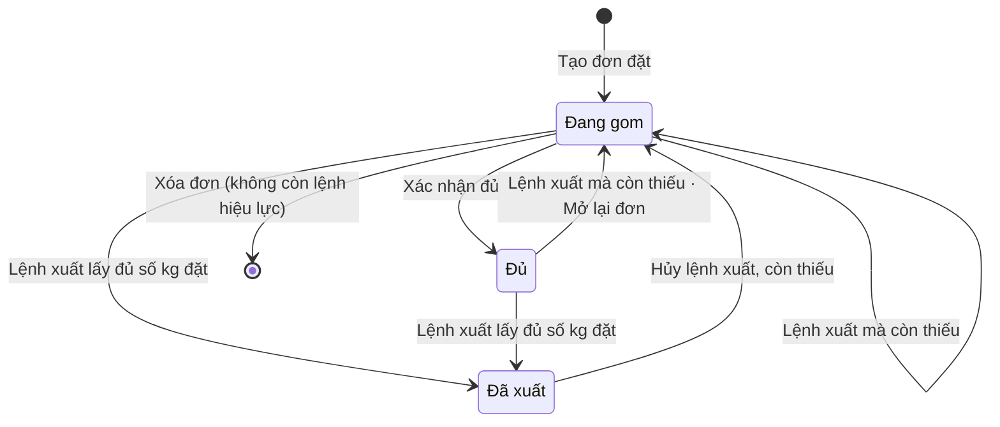
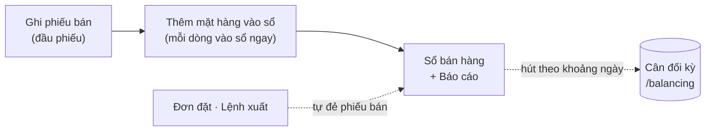
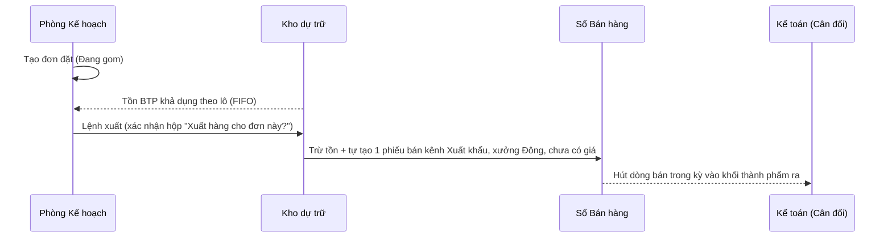

# Kinh doanh — sơ đồ workflow

> Load khi: review / kiểm lại trang Bán hàng (`/sales`) và Đơn đặt (`/orders`), trước khi sửa luật phiếu bán, ghi bù, trừ tồn, lệnh xuất. Bản đọc nhanh — luật đầy đủ ở [33-ban-hang](../app-map/33-ban-hang.md) · ba-spec [34](../app-map/34-btp-san-xuat-kho.ba-spec.md) · [53](../app-map/53-filters.ba-spec.md).
covers: src/features/sales/*, src/features/orders/*, src/lib/salesTotals.ts, src/lib/inventory.ts, src/lib/orderExportReversal.ts
tours: src/features/sales/salesTour.ts, src/features/orders/ordersTour.ts
guides: src/features/shared/guideContent.tsx
last_verified: 2026-11-06
ttl_days: 90

Sửa code trong `covers:` mà không sửa file này ⇒ commit bị chặn ([README](README.md) § Luật đồng bộ).

"Bán hàng" là bán **thành phẩm ra cho khách**. Khác "bán thành phẩm" (BTP, công đoạn sản xuất). Đơn đặt là đơn xuất khẩu.

## 1. Một đơn đặt đi qua những trạng thái nào

Phiếu bán không có máy trạng thái. Chỉ có cờ **Ghi bù** (`isBackdatedSales`: ngày ghi sổ sau ngày xuất bán, bắt buộc lý do). Máy trạng thái nằm ở **Đơn đặt** (`SalesOrder["status"]`).

| Trạng thái | Nghĩa | Sang bước sau khi | Ai làm | Code |
|---|---|---|---|---|
| Đang gom | Đơn mới, còn thiếu hàng so với số đã đặt | Bấm **Xác nhận đủ**; hoặc **Lệnh xuất (một phần được)** lấy đủ kg đặt của mọi dòng | Người có quyền Sửa (xác nhận) / Thêm (lệnh xuất) trên Đơn đặt | `STATUS_LABELS` · `confirmFulfilled` |
| Đủ | Đã đánh dấu gom đủ hàng, chưa xuất kho | **Lệnh xuất**: đủ kg ⇒ Đã xuất; còn thiếu ⇒ quay về Đang gom. Bấm nhầm Xác nhận đủ ⇒ **Mở lại đơn** về Đang gom (không đụng tồn, có Hoàn tác) | Người có quyền Thêm (lệnh xuất) / Sửa (mở lại) | `createExportOrder` · `reopenOrder` · `canReopenOrder` |
| Đã xuất | Đơn đóng, ẩn hai nút Xác nhận đủ và Lệnh xuất | Hủy lệnh xuất làm đơn thiếu lại ⇒ về Đang gom | — | `createExportOrder` (đủ khi còn lại ≤ 0,001 kg) · `orderStatusFromExports` |

Sau lệnh xuất, mỗi dòng đơn so `requiredQuantityKg` với số đã xuất (`exportedKg`). Còn thiếu dòng nào ⇒ đơn vẫn **Đang gom**.

### Lệnh xuất: Đã lập → Đã hủy

| Trạng thái lệnh | Nghĩa | Sang bước sau khi | Ai làm | Code |
|---|---|---|---|---|
| Đã lập (`closed`) | Dòng lệnh đã trừ tồn từng lô; phiếu bán kênh Xuất khẩu mang **đúng id của lệnh** (lệnh lập trước 06/11/2026: dò phiếu cùng khách · ngày giao = ngày xuất · đủ bộ mặt hàng × quy cách × kg · nguồn "Đơn đặt") | **Hủy lệnh xuất** ở mục Lệnh xuất đã lập: ghi **Lý do hủy** (bắt buộc, có nháp), xác nhận | Người có quyền Xóa ở **cả** Đơn đặt **lẫn** Bán hàng (mặc định: Kế toán trưởng) | `openCancelExport` · `checkExportReversal` · `findLinkedSalesInvoice` |
| Đã hủy (`cancelled`) | Dòng lệnh bị xóa ⇒ tồn trả về đúng lô, đúng kg; phiếu bán + dòng bán đi kèm bị gỡ; dấu quét kiểm của lệnh bị gỡ. Đầu lệnh còn lại với nhãn **Đã hủy** + ghi chú "Đã hủy ‹ngày› · ‹người›: ‹lý do› (đã trả … kg về … lô, gỡ phiếu bán … dòng)". Đơn tính lại trạng thái theo các lệnh còn hiệu lực | Hết (muốn xuất lại thì lập lệnh mới). Toast **Hoàn tác** trả nguyên mọi sổ | — | `reverseExportOrder` · `orderStatusFromExports` |

Hủy lệnh xuất **bị chặn** khi Cân đối kỳ đã hút dòng bán của phiếu (`balancing_outputs.sales_item_id`) — gỡ dòng ở Cân đối trước. Phiếu bán đã bị xóa ở Bán hàng ⇒ vẫn hủy được, chỉ trả tồn. Giá đã ghi trên dòng bán mất theo phiếu (hộp hủy báo trước số dòng có giá).

**Xóa đơn** (nút trong chi tiết đơn, `ConfirmDelete` + Hoàn tác — không còn nút Bỏ trên dòng bảng): chỉ khi đơn **không còn lệnh xuất hiệu lực**; còn ⇒ báo phải Hủy lệnh xuất trước (`checkOrderDelete`). Đầu lệnh đã hủy đi theo đơn.

Sau lệnh xuất, mỗi dòng đơn so `requiredQuantityKg` với số đã xuất (`exportedKg`). Còn thiếu dòng nào ⇒ đơn vẫn **Đang gom**.

## 2. Từ phiếu bán đến sổ cân đối

| Bước | Mục | Xong khi | Ai làm |
|---|---|---|---|
| 1 · Đầu phiếu | Ngày ghi sổ · Ngày xuất bán · Phân xưởng · Khách · Kênh bán · Ghi chú | Ngày ghi sổ không trước ngày xuất bán; khác ngày ⇒ có **Lý do ghi bù** (`invoiceHeaderErrors`). Mọi tổng hợp tính theo **Ngày xuất bán** | Người có quyền Thêm |
| 2 · Dòng hàng | Mặt hàng · Quy cách · Nguồn bán · kg · đơn giá | Chọn mặt hàng và kg lớn hơn 0 (báo "Chưa chọn mặt hàng", "Phải lớn hơn 0 kg"). Bấm **Thêm mặt hàng vào sổ** là vào sổ ngay | Người có quyền Thêm |
| 3 · Trừ tồn | Nguồn bán: **Block thô (kho dự trữ)** (`RETAIL_WAREHOUSE`) trừ tồn BTP; **Đóng gói (kho thành phẩm)** (`FG_WAREHOUSE`) trừ tồn thành phẩm | Tự tính theo FIFO, bán vượt chỉ cảnh báo (vẫn ghi được). Xóa / sửa dòng ⇒ tồn tự hồi | Hệ thống |
| 4 · Kênh và tiền | Kênh **Xuất khẩu** (USD) · **Nội địa** (VND) | Tiền cuối sổ tách theo kênh, không cộng USD với VND (`sumSalesAmountByChannel`). Kg thì cộng chung | Hệ thống |
| 5 · Báo cáo | Tab **Sổ bán hàng** · **Báo cáo** (gom khách × kênh) | Giá trị chỉ hiện cho người có quyền Xem giá | Người có quyền Xem |
| 6 · Hút vào cân đối | Nút "Lấy N dòng từ sổ bán" ở khối Bán thành phẩm sản xuất | Dòng bán có Ngày xuất bán trong kỳ, chưa hút (`salesItemId`) được **sao chép** thành dòng kỳ; sổ bán không đổi (`salesItemToOutput`) | Người có quyền Sửa Cân đối (kỳ chưa chốt) |

Dòng bán thuộc lệnh xuất mang nguồn `"Đơn đặt"`. Hàm `filterRetailSales` bỏ dòng này khỏi phần trừ tồn bán lẻ, vì lệnh xuất đã trừ rồi.

## 3. Chỗ bàn giao giữa bộ phận

- Lệnh xuất chạm hai sổ cùng lúc nên có hộp xác nhận; lập nhầm thì **Hủy lệnh xuất** (đảo cả hai sổ, xem §1). Chưa có tồn khả dụng ⇒ cảnh báo, không tạo gì.
- **Kiểm lô bằng quét** (quét tem từng block lúc xếp container) là bước thêm sau lệnh xuất, không đổi trạng thái đơn. Quét nhầm ⇒ **Bỏ kiểm** ở dòng lô (hỏi lại + Hoàn tác): xóa dấu `export_item` của lô trong lệnh, lô về Chưa quét; dòng lệnh, tồn không đổi.
- Hút vào cân đối là bản sao. Sửa giá ở sổ bán sau khi hút thì bản sao không tự đổi.

## 5. Ai được làm gì

Sinh từ ma trận quyền mặc định (vai đã chỉnh ở /roles có thể khác). Admin luôn đủ quyền.

<!-- gen:roles — sinh tự động từ src/lib/permissions.ts, đừng sửa tay -->
**Bán hàng** (`sales`)

| Vai | Xem | Thêm | Sửa | Xóa | Chốt | Mở lại | Xem giá |
|---|---|---|---|---|---|---|---|
| Giám đốc | ✓ |  |  |  |  |  | ✓ |
| Phó giám đốc | ✓ |  |  |  |  |  | ✓ |
| Kế toán trưởng | ✓ | ✓ | ✓ | ✓ | ✓ | ✓ | ✓ |
| Kế toán | ✓ | ✓ | ✓ |  |  |  | ✓ |

**Đơn đặt** (`orders`)

| Vai | Xem | Thêm | Sửa | Xóa |
|---|---|---|---|---|
| Giám đốc | ✓ |  |  |  |
| Phó giám đốc | ✓ |  |  |  |
| Kế toán trưởng | ✓ | ✓ | ✓ | ✓ |
| Kế toán | ✓ | ✓ | ✓ |  |
| Nhân viên Kế hoạch | ✓ |  |  |  |
| Trưởng phòng Kế hoạch | ✓ |  |  |  |
| Phó phòng Kế hoạch | ✓ |  |  |  |
<!-- /gen:roles -->

## 6. Nối với module khác

| Sang | Khi nào | Luật |
|---|---|---|
| Báo cáo & Cân đối (`/balancing`) | Hút dòng bán trong kỳ vào khối thành phẩm ra | [31-can-doi-ky](../app-map/31-can-doi-ky.md) |
| Kho (`/warehouse`) | Tồn BTP và thành phẩm dùng để trừ khi bán và xuất | ba-spec 34 |
| Báo cáo đơn xuất (`/export-report`) | Lệnh xuất theo ngày xuất, gom theo đơn | ba-spec 34 |
| Danh mục | Khách, mặt hàng chọn từ danh mục, thêm mới ngay trong ô | [32-danh-muc](../app-map/32-danh-muc.md) |
| Truy xuất QR (`/qr`) | Gắn lô cho dòng bán lẻ; kiểm lô lệnh xuất | spec qr-truy-xuat-lo |

## Lịch sử

- 2026-11-03 — tạo.
- 2026-11-06 — gỡ được việc làm nhầm: Hủy lệnh xuất (trả tồn + gỡ phiếu bán, giữ đầu lệnh Đã hủy), Mở lại đơn, Xóa đơn trong chi tiết (chặn khi còn lệnh), Bỏ kiểm lô.
