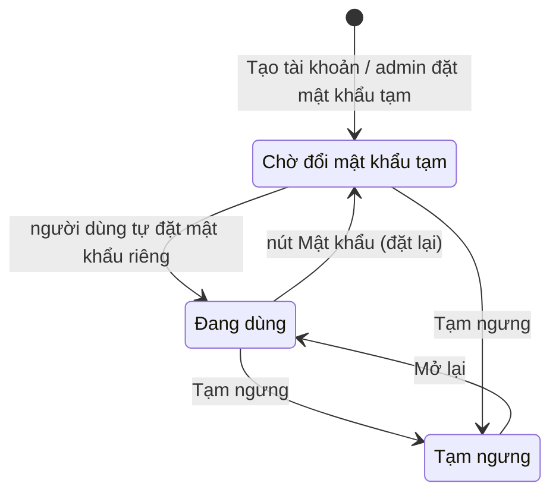
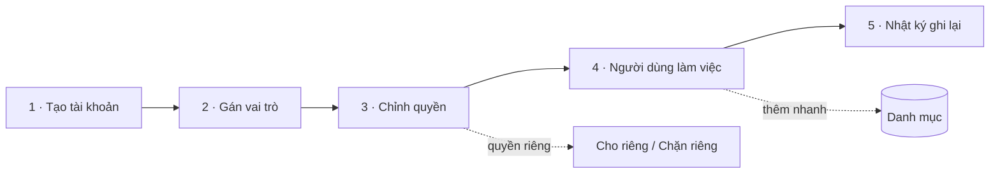
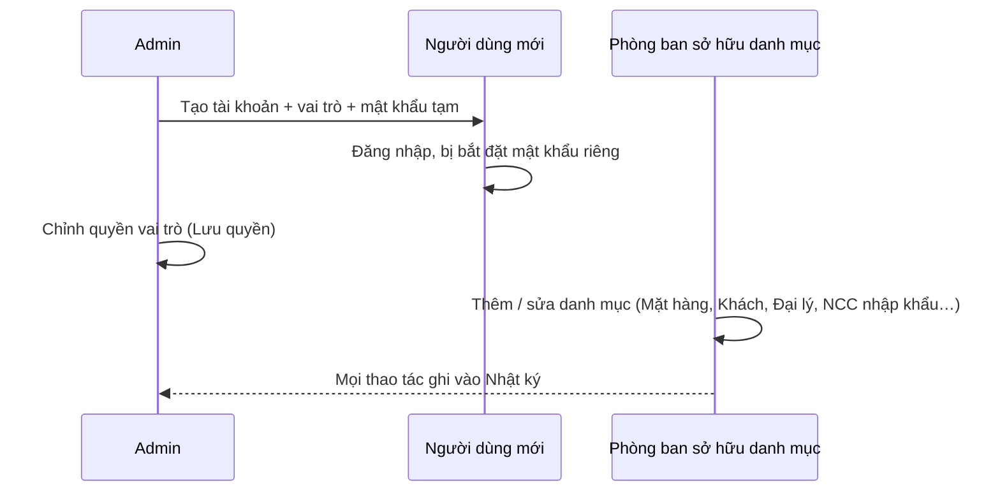

# Danh mục · Quản trị — sơ đồ workflow

> Load khi: review / kiểm lại các trang `/catalog` (Danh mục), `/admin` (Quản trị), `/users` (Người dùng), `/roles` (Vai trò & quyền), `/audit` (Nhật ký thao tác); trước khi sửa luật tài khoản, ma trận quyền, danh mục dùng chung. Bản đọc nhanh — luật đầy đủ ở [32-danh-muc](../app-map/32-danh-muc.md) · [05-bao-mat-phan-quyen](../app-map/05-bao-mat-phan-quyen.md) · [56](../app-map/56-activity-log-groups.ba-spec.md).
covers: src/features/catalog/*, src/features/users/*, src/features/admin/*, src/features/audit/*, src/lib/permissions.ts, src/lib/audit.ts, src/lib/userDirectory.ts, src/lib/catalogRepo.ts, src/lib/productUsage.ts
tours: src/features/catalog/catalogTour.ts
guides: src/features/shared/guideContent.tsx
last_verified: 2026-11-03
ttl_days: 90

Sửa code trong `covers:` mà không sửa file này ⇒ commit bị chặn ([README](README.md) § Luật đồng bộ). Bốn trang quản trị là tài nguyên `adminOnly`: chỉ admin vào được, ma trận quyền không cấp cho ai khác (`isGrantable`).

## 1. Các đối tượng và trạng thái

Không có một máy trạng thái chung. Ba đối tượng có trạng thái: **tài khoản**, **vai trò**, **NCC nhập khẩu** (trong Danh mục). Các bản ghi danh mục còn lại không có trạng thái: xóa qua xác nhận + Hoàn tác.

### 1a. Tài khoản đăng nhập (màn Người dùng)

| Trạng thái | Nghĩa | Sang bước sau khi | Ai làm | Code |
|---|---|---|---|---|
| Chờ đổi mật khẩu tạm | Mật khẩu do admin đặt, người dùng bị bắt đặt mật khẩu riêng ở lần vào | Người dùng đặt mật khẩu mới (`SetOwnPasswordScreen`) | Người dùng | `AccountStatusCell` · `mustChangePassword` |
| Đang dùng | Đăng nhập bình thường | Admin **Tạm ngưng**, hoặc đặt lại bằng nút **Mật khẩu** | Admin | `accountStateOf` |
| Tạm ngưng | Không đăng nhập được, máy đang mở bị đăng xuất. Hồ sơ, vai trò, quyền riêng, sổ đã ghi giữ nguyên | Admin bấm **Mở lại** (hỏi xác nhận khi Tạm ngưng, có Hoàn tác) | Admin | `AccountStatusCell` |

- Admin không tự Tạm ngưng hoặc tự đặt lại mật khẩu của chính mình (nút ẩn ở dòng của mình).
- Mật khẩu tối thiểu 6 ký tự. Tên đăng nhập chỉ chữ thường không dấu và số (`normalizeUsername`). Đăng ký không mở tự do: chỉ admin **Tạo tài khoản**.
- Người chưa có vai trò vẫn đăng nhập được nhưng không mở được màn nào. Tổng quan quản trị đếm ở thẻ "Chưa gán vai trò".
- Cột Trạng thái và ba nút Mật khẩu / Tạm ngưng cần migration 0080 trên máy chủ; chưa chạy ⇒ cột ẩn, nút báo lỗi.
- Tài khoản đăng nhập chưa có hồ sơ: nút **Tạo hồ sơ** hoặc dọn (**Xóa vĩnh viễn**, chỉ khi không còn dữ liệu gắn cứng).

### 1b. Vai trò (màn Vai trò & quyền)

| Trạng thái | Nghĩa | Sang bước sau khi | Ai làm | Code |
|---|---|---|---|---|
| Toàn quyền | Vai trò `admin`, không có ma trận để chỉnh | — | | `resolvePermissions` (`isAdmin`) |
| (mặc định) | Vai trò hệ thống đang dùng ma trận mặc định | Tick ô rồi **Lưu quyền** ⇒ thành Đã chỉnh | Admin | `DEFAULT_ROLE_PERMISSIONS` |
| Đã chỉnh | Vai trò hệ thống có ma trận riêng | **Khôi phục mặc định** (có Hoàn tác) | Admin | `buildRolePermissions` |
| Tự tạo | Vai trò admin tạo (**Tạo vai trò mới** hoặc **Sao chép**) | **Xóa vai trò**, chỉ khi không còn ai giữ | Admin | `listRoleOptions` |

Luật ma trận (`resolvePermissions`):

- Mười hành động: Xem · Thêm · Sửa · Xóa · Chốt · Mở lại · Duyệt · Nạp file · Xuất / In · Xem giá (`PERMISSION_ACTION_LABELS`).
- Có hành động nào ⇒ có Xem. Chặn riêng Xem của một tài nguyên ⇒ gỡ mọi hành động của tài nguyên đó.
- Tab **Theo người dùng**: ô "Cho riêng người này (ngoài vai trò)" và "Chặn riêng người này". Chặn riêng thắng quyền theo vai trò.
- Một người nhiều vai trò: quyền là hợp các vai trò, phạm vi rộng hơn thắng (`widerScope`).
- Ai đã có quyền ở đâu đó thì tự có Xem Việc của tôi và Tài liệu công ty.
- Vai trò chọn **Thuộc phòng ban** để quyết định xem tài liệu công ty của phòng nào.

### 1c. NCC nhập khẩu (tab trong Danh mục)

| Trạng thái | Nghĩa | Sang bước sau khi | Ai làm | Code |
|---|---|---|---|---|
| Đang giao dịch | Chọn được cho hợp đồng nhập mới | Chuyển Ngừng giao dịch | Nhân viên Kế hoạch | `selectableImportSuppliers` |
| Ngừng giao dịch | Hợp đồng cũ giữ tên, không chọn cho hợp đồng mới | Chuyển lại Đang giao dịch | Nhân viên Kế hoạch | `canDeleteImportSupplier` |

NCC đã có hợp đồng nhập (kể cả đã hủy) không xóa được, chỉ chuyển Ngừng giao dịch.

## 2. Các bước của luồng

| Bước | Mục | Xong khi | Ai làm |
|---|---|---|---|
| 1 · Tạo tài khoản | Nút **Tạo tài khoản**: họ tên, tên đăng nhập, mật khẩu, vai trò | Tên đăng nhập không trùng, mật khẩu ≥ 6 ký tự; phiên admin không bị đá văng (`createAccount`) | Admin |
| 2 · Gán vai trò | Nút **Sửa** ở dòng người dùng (một hoặc nhiều vai trò) | Có vai trò ⇒ mở được màn; có hiệu lực ở lần vào màn kế tiếp | Admin |
| 3 · Chỉnh quyền | Vai trò & quyền ⇒ **Lưu quyền**; hoặc nút **Quyền** ở màn Người dùng | Ma trận ghi xong; người giữ vai trò thấy khi mở lại app hoặc quay lại tab | Admin |
| 4 · Làm việc | Danh mục: tab **Mặt hàng**, **Khách hàng**, **Đại lý**, **NCC nhập khẩu**, **Loại nguyên liệu**, **Bột tẩm**, **Kho lưu trữ**, **Thành phẩm (141 mã)** | Mỗi tab theo tài nguyên `catalog.*` của nó; ô chọn danh mục ở màn nghiệp vụ thêm mới / sửa nhanh được ngay | Người có quyền tab đó |
| 5 · Nhật ký | Nhật ký thao tác: lọc Từ ngày · Đến ngày · Thao tác · Đối tượng · Người · Tìm nhanh; **Tải lại**, **Xuất Excel**, **Chi tiết**, **Tải thêm 1.000** | Chỉ xem, nhật ký chỉ thêm, không sửa hay xóa (`appendAuditEntries`) | Admin |

Luật Danh mục (`catalogConfig.tsx`):

- Thành phẩm (141 mã) chỉ đọc trong app: dữ liệu gốc là seed (`finished-goods.json`), không sửa tay ở màn.
- Đại lý (đầu vào) khác Khách hàng (đầu ra) khác NCC nhập khẩu. Không gộp.
- Sổ nghiệp vụ lưu **tên** của danh mục, nên đổi tên không hồi tố vào dòng đã ghi.
- Kho lưu trữ: tên không được trùng (tên là chỗ nối dữ liệu). Khách hàng, Đại lý: báo lỗi khi mã số trùng (`checkDuplicateCode`).
- Xóa mặt hàng ngay trong ô chọn: đếm nơi đang dùng (`findProductUsage`); đang dùng thì chặn và nêu sổ, chưa dùng thì xác nhận + Hoàn tác.

Nhật ký ghi các thao tác thêm / sửa / xóa dữ liệu, đăng nhập / đăng xuất, đổi mật khẩu, đặt lại mật khẩu, tạm ngưng và mở lại tài khoản. Không ghi điều hướng hay mở hộp thoại.

## 3. Chỗ bàn giao giữa bộ phận

- Quên mật khẩu: không gửi email được (email đăng nhập là email tổng hợp). Màn đăng nhập chỉ hướng dẫn báo admin; admin đặt mật khẩu tạm.
- Tab NCC nhập khẩu do Phòng Kế hoạch giữ; thủ kho và xưởng không thấy (`catalog.import-suppliers` không nằm trong `CATALOG_TABS`).

## 5. Ai được làm gì

Sinh từ ma trận quyền mặc định (vai đã chỉnh ở /roles có thể khác). Admin luôn đủ quyền. Bốn trang Quản trị (`admin`, `users`, `roles`, `audit`) chỉ admin dùng nên không có bảng.

<!-- gen:roles — sinh tự động từ src/lib/permissions.ts, đừng sửa tay -->
**Danh mục · Đại lý** (`catalog.suppliers`)

| Vai | Xem | Thêm | Sửa | Xóa |
|---|---|---|---|---|
| Giám đốc | ✓ |  |  |  |
| Phó giám đốc | ✓ |  |  |  |
| Quản đốc xưởng Đông | ✓ |  |  |  |
| Quản đốc xưởng Cá | ✓ |  |  |  |
| Quản đốc xưởng Khô | ✓ |  |  |  |
| Phó quản đốc | ✓ |  |  |  |
| Tổ trưởng sản xuất | ✓ |  |  |  |
| Thủ kho nhập hàng | ✓ | ✓ | ✓ |  |
| Kế toán trưởng | ✓ | ✓ | ✓ | ✓ |
| Kế toán | ✓ | ✓ | ✓ |  |
| Nhân viên Kế hoạch | ✓ |  |  |  |
| Trưởng phòng Kế hoạch | ✓ |  |  |  |
| Phó phòng Kế hoạch | ✓ |  |  |  |

**Danh mục · NCC nhập khẩu** (`catalog.import-suppliers`)

| Vai | Xem | Thêm | Sửa | Xóa |
|---|---|---|---|---|
| Giám đốc | ✓ |  |  |  |
| Phó giám đốc | ✓ |  |  |  |
| Kế toán trưởng | ✓ |  |  |  |
| Kế toán | ✓ |  |  |  |
| Nhân viên Kế hoạch | ✓ | ✓ | ✓ | ✓ |
| Trưởng phòng Kế hoạch | ✓ | ✓ | ✓ | ✓ |
| Phó phòng Kế hoạch | ✓ | ✓ | ✓ | ✓ |

**Danh mục · Khách hàng** (`catalog.customers`)

| Vai | Xem | Thêm | Sửa | Xóa |
|---|---|---|---|---|
| Giám đốc | ✓ |  |  |  |
| Phó giám đốc | ✓ |  |  |  |
| Quản đốc xưởng Đông | ✓ |  |  |  |
| Quản đốc xưởng Cá | ✓ |  |  |  |
| Quản đốc xưởng Khô | ✓ |  |  |  |
| Phó quản đốc | ✓ |  |  |  |
| Tổ trưởng sản xuất | ✓ |  |  |  |
| Thủ kho nhập hàng | ✓ |  |  |  |
| Kế toán trưởng | ✓ | ✓ | ✓ | ✓ |
| Kế toán | ✓ | ✓ | ✓ |  |
| Nhân viên Kế hoạch | ✓ | ✓ | ✓ |  |
| Trưởng phòng Kế hoạch | ✓ | ✓ | ✓ |  |
| Phó phòng Kế hoạch | ✓ | ✓ | ✓ |  |

**Danh mục · Loại nguyên liệu** (`catalog.material-types`)

| Vai | Xem | Thêm | Sửa | Xóa |
|---|---|---|---|---|
| Giám đốc | ✓ |  |  |  |
| Phó giám đốc | ✓ |  |  |  |
| Quản đốc xưởng Đông | ✓ |  |  |  |
| Quản đốc xưởng Cá | ✓ |  |  |  |
| Quản đốc xưởng Khô | ✓ |  |  |  |
| Phó quản đốc | ✓ |  |  |  |
| Tổ trưởng sản xuất | ✓ |  |  |  |
| Thủ kho nhập hàng | ✓ | ✓ | ✓ |  |
| Kế toán trưởng | ✓ | ✓ | ✓ | ✓ |
| Kế toán | ✓ | ✓ | ✓ |  |
| Nhân viên Kế hoạch | ✓ |  |  |  |
| Trưởng phòng Kế hoạch | ✓ |  |  |  |
| Phó phòng Kế hoạch | ✓ |  |  |  |

**Danh mục · Mặt hàng** (`catalog.products`)

| Vai | Xem | Thêm | Sửa | Xóa |
|---|---|---|---|---|
| Giám đốc | ✓ |  |  |  |
| Phó giám đốc | ✓ |  |  |  |
| Quản đốc xưởng Đông | ✓ | ✓ | ✓ |  |
| Quản đốc xưởng Cá | ✓ | ✓ | ✓ |  |
| Quản đốc xưởng Khô | ✓ | ✓ | ✓ |  |
| Phó quản đốc | ✓ |  |  |  |
| Tổ trưởng sản xuất | ✓ |  |  |  |
| Thủ kho nhập hàng | ✓ |  |  |  |
| Kế toán trưởng | ✓ | ✓ | ✓ | ✓ |
| Kế toán | ✓ | ✓ | ✓ |  |
| Nhân viên Kế hoạch | ✓ |  |  |  |
| Trưởng phòng Kế hoạch | ✓ |  |  |  |
| Phó phòng Kế hoạch | ✓ |  |  |  |

**Danh mục · Bột tẩm** (`catalog.batters`)

| Vai | Xem | Thêm | Sửa | Xóa |
|---|---|---|---|---|
| Giám đốc | ✓ |  |  |  |
| Phó giám đốc | ✓ |  |  |  |
| Quản đốc xưởng Đông | ✓ | ✓ | ✓ |  |
| Quản đốc xưởng Cá | ✓ | ✓ | ✓ |  |
| Quản đốc xưởng Khô | ✓ | ✓ | ✓ |  |
| Phó quản đốc | ✓ |  |  |  |
| Tổ trưởng sản xuất | ✓ |  |  |  |
| Thủ kho nhập hàng | ✓ |  |  |  |
| Kế toán trưởng | ✓ | ✓ | ✓ | ✓ |
| Kế toán | ✓ | ✓ | ✓ |  |
| Nhân viên Kế hoạch | ✓ |  |  |  |
| Trưởng phòng Kế hoạch | ✓ |  |  |  |
| Phó phòng Kế hoạch | ✓ |  |  |  |

**Danh mục · Kho lưu** (`catalog.storage-locations`)

| Vai | Xem | Thêm | Sửa | Xóa |
|---|---|---|---|---|
| Giám đốc | ✓ |  |  |  |
| Phó giám đốc | ✓ |  |  |  |
| Quản đốc xưởng Đông | ✓ |  |  |  |
| Quản đốc xưởng Cá | ✓ |  |  |  |
| Quản đốc xưởng Khô | ✓ |  |  |  |
| Phó quản đốc | ✓ |  |  |  |
| Tổ trưởng sản xuất | ✓ |  |  |  |
| Thủ kho nhập hàng | ✓ |  |  |  |
| Kế toán trưởng | ✓ | ✓ | ✓ | ✓ |
| Kế toán | ✓ | ✓ | ✓ |  |
| Nhân viên Kế hoạch | ✓ |  |  |  |
| Trưởng phòng Kế hoạch | ✓ |  |  |  |
| Phó phòng Kế hoạch | ✓ |  |  |  |

**Danh mục · Thành phẩm (141 mã)** (`catalog.finished-goods`)

| Vai | Xem | Sửa |
|---|---|---|
| Giám đốc | ✓ |  |
| Phó giám đốc | ✓ |  |
| Quản đốc xưởng Đông | ✓ |  |
| Quản đốc xưởng Cá | ✓ |  |
| Quản đốc xưởng Khô | ✓ |  |
| Phó quản đốc | ✓ |  |
| Tổ trưởng sản xuất | ✓ |  |
| Thủ kho nhập hàng | ✓ |  |
| Kế toán trưởng | ✓ |  |
| Kế toán | ✓ |  |
| Nhân viên Kế hoạch | ✓ |  |
| Trưởng phòng Kế hoạch | ✓ |  |
| Phó phòng Kế hoạch | ✓ |  |
<!-- /gen:roles -->

## 6. Nối với module khác

| Sang | Khi nào | Luật |
|---|---|---|
| Mọi màn nghiệp vụ | Ô chọn danh mục có thêm mới + bút chì sửa nhanh | quy tắc code 7 · `useQuickCatalogEdit` |
| Nhập khẩu (`/planning-import`) | Đối tác chọn từ tab NCC nhập khẩu; dòng hàng nối tab Mặt hàng | ba-spec 45 R15 · R20 |
| Tài liệu (`/documents`) | Phòng ban của vai trò quyết định xem tài liệu | `departmentsOfRoles` |
| Việc của tôi | Quyền quyết định việc nào hiện, ai giao được | `taskRequirements` |
| Tổng quan | Thẻ Tổng quan quản trị: Chưa gán vai trò, Vai trò, Người có quyền riêng | `AdminHomeScreen` |

## Lịch sử

- 2026-11-03 — tạo.
