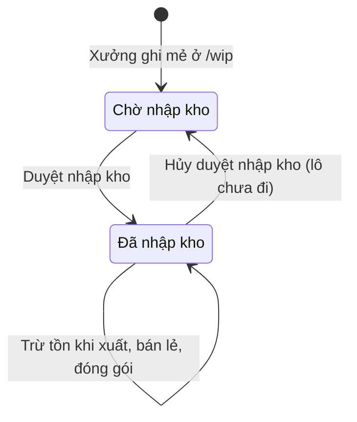
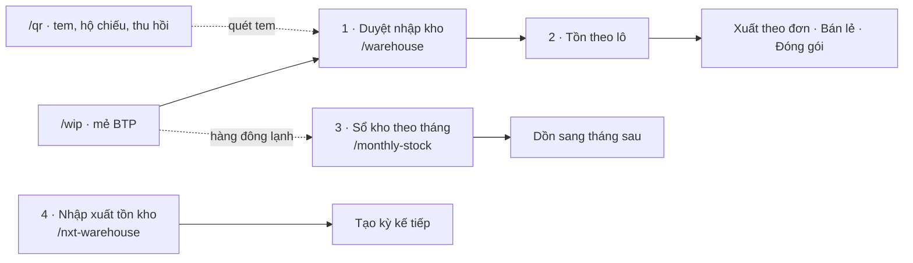
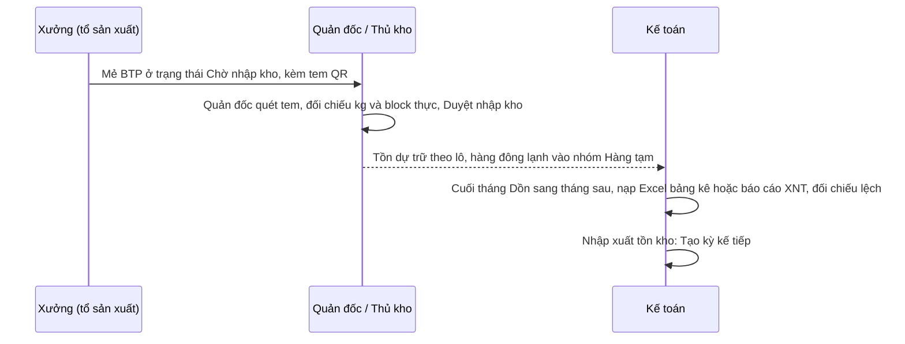

# Kho — sơ đồ workflow

> Load khi: review / kiểm lại các trang Kho dự trữ (`/warehouse`), Sổ kho theo tháng (`/monthly-stock`), Mã lô QR (`/qr`), Nhập xuất tồn kho (`/nxt-warehouse`). Trước khi sửa luật duyệt nhập kho, tồn theo lô, dồn tồn tháng, tem QR. Bản đọc nhanh — luật đầy đủ ở ba-spec [34](../app-map/34-btp-san-xuat-kho.ba-spec.md) · [36](../app-map/36-so-kho-thang.md) · [spec qr-truy-xuat-lo](../spec/qr-truy-xuat-lo.md).
covers: src/features/warehouse/*, src/features/monthly-stock/*, src/features/qr/*, src/features/reports/WarehouseNxtScreen.tsx, src/lib/inventory.ts, src/lib/wipIntakeReversal.ts, src/lib/lotTraceability.ts, src/lib/monthlyStock*.ts, src/lib/frozenStockLines.ts, src/lib/nxtExcel.ts, src/lib/nxtStockImport.ts, src/lib/nxtReportFile.ts
tours: src/features/warehouse/warehouseTour.ts, src/features/monthly-stock/monthlyStockTour.ts, src/features/qr/qrTour.ts, src/features/reports/warehouseNxtTour.ts
guides: src/features/shared/guideContent.tsx, src/features/shared/guides/warehouseNxtGuide.tsx
last_verified: 2026-11-06
ttl_days: 90

Sửa code trong `covers:` mà không sửa file này ⇒ commit bị chặn ([README](README.md) § Luật đồng bộ).

## 1. Một lô bán thành phẩm đi qua những trạng thái nào

Lô = một mẻ sản xuất ghi ở `/wip`. Trạng thái nằm ở `WipWarehouseStatus`.

| Trạng thái | Nghĩa | Sang bước sau khi | Ai làm | Code |
|---|---|---|---|---|
| Chờ nhập kho | Mẻ đã ghi, chưa tính vào tồn. Hiện ở khối "Có N lô sản xuất chờ nhập kho" | Bấm **Duyệt nhập kho**, chọn Kho (phòng đông), gõ Khối lượng thực và Block thực (mặc định = số xưởng ghi), ghi lý do lệch nếu có. Phải có kho và khối lượng > 0. Duyệt ghi số thực vào mẻ và **chụp số xưởng ghi** (kg, block, kho, ghi chú, ai / lúc duyệt) vào `preApproval` (cột `pre_approval`, mig 0108) | Quản đốc / Phó quản đốc xưởng (quyền Duyệt), chỉ lô của xưởng mình | `saveApproval` · `approveWipIntake` · `canRow("approve", …)` |
| Đã nhập kho | Tính vào tồn dự trữ. Từ đây mới xuất bán hoặc đóng gói được. Bảng tồn → **Xem** mở chi tiết lô: Kho nhận · Xưởng ghi · Đã xuất / còn | Hết tồn thì không còn hiện (chỉ hiện lô còn `remainingKg > 0`). Duyệt nhầm ⇒ **Hủy duyệt nhập kho** trong chi tiết lô (hỏi lại + Hoàn tác): về Chờ nhập kho với đúng số xưởng ghi, xóa bản chụp. Lô duyệt trước 06/11/2026 không có bản chụp ⇒ chỉ đổi trạng thái, giữ số đang có | Hệ thống tự trừ · Hủy duyệt: người có quyền Duyệt, lô xưởng mình | `computeWipStockDetail` · `checkIntakeReversal` · `revertWipIntake` |

Hủy duyệt **bị chặn** (chi tiết lô ghi rõ lý do + chỗ sửa) khi lô đã đi: có trong dòng lệnh xuất (Hủy lệnh xuất ở Đơn đặt trước) · làm đầu vào phiếu đóng gói (`lot_inputs`) · gắn cho dòng bán (`lot_dispatches` khác `export_item`) · bán lẻ / đóng gói FIFO đã trừ vào lô (`outKg > 0`) · kỳ Cân đối đã hút mẻ (`balancingPeriodId`) mà hủy làm đổi số kg.

Quy tắc tồn:
- Tồn lô = kg nhập kho − kg lệnh xuất − kg bán lẻ / đóng gói đã trừ. Lô gắn QR thì trừ đúng lô, phần còn lại trừ theo thứ tự cũ trước (`collectWipDeductions`).
- Lô không xuống âm. Phần bán quá tồn hiện dòng cảnh báo "Bán vượt …", không bị nuốt.
- Khối "Hàng nằm kho bao lâu" chia tồn: Dưới 30 ngày · 30–60 ngày · 60–90 ngày · Trên 90 ngày. Chỉ hiển thị, không đổi tồn.
- Thẻ "Dung tích & Tải trọng Kho BSF1": 5 kho; vượt sức chứa thì tô đỏ (`computeWarehouseOccupancy`).

### Tem của một lô (trang `/qr`)

Mỗi lô thuộc một trong các loại (`TRACE_KIND_LABELS`): Nguyên liệu · Bán thành phẩm · Thành phẩm. Hàng đã rời xưởng là ba loại lá: Xuất theo đơn · Bán lẻ · Bán nội địa.

| Trạng thái tem | Nghĩa | Sang bước sau khi |
|---|---|---|
| Chưa in tem | Chưa có dòng nào trong sổ in tem | Bấm in. Mặc định số tem = số block (BTP), số thùng (TP), 1 (NL) |
| Đã in N tem | Có sổ in, ghi người in và lúc in | In lại khi tem bong hoặc mờ |
| Nhãn đã đổi | Nhãn in trên tem khác nhãn suy ra hiện tại (sửa ngày hoặc xưởng sau khi in) | QR vẫn đúng vì theo id. In lại nếu cần |

## 2. Luồng qua bốn trang

| Bước | Mục | Xong khi | Ai làm |
|---|---|---|---|
| 1 · Duyệt nhập kho | Danh sách chờ; quét camera hoặc gõ mã lô trên tem rồi bấm "Tìm lô". Gỡ: bảng tồn → Xem → Hủy duyệt nhập kho | Lô sang Đã nhập kho. Quét tem mở thẳng hộp duyệt đúng mẻ. Báo nếu không phải tem BTP, mã trùng nhiều lô, lô đã nhập kho, hoặc lô của xưởng khác (`approveByLabel`) | Quản đốc / Phó quản đốc |
| 2 · Tồn theo lô | Bảng tồn, lọc theo Kho, ô "Tra mặt hàng, quy cách, kho" | Chỉ đọc. Ghi hàng ra ở Đơn đặt, Bán hàng, Đóng gói | Thủ kho · Kế toán · Quản đốc xem |
| 3 · Sổ kho theo tháng | Bảng theo nhóm hàng; gõ thẳng ngày nhập, size, invoice, đơn giá, tồn đầu, nhập, xuất, vị trí | Tồn cuối và Tiền còn lại luôn được tính, không lưu: Tồn cuối = tồn đầu + nhập − xuất, Tiền còn lại = tồn cuối × đơn giá (`deriveRow`). Thanh "Khớp bất biến" đối chiếu | Kế toán |
| 3a · Dồn tháng | **Dồn sang tháng sau** (đẩy, mọi kho) hoặc **Kế thừa & lưu vào sổ** (kéo, ở banner xem trước của tháng trống) | Tồn đầu tháng đích = tồn cuối tháng nguồn. Chỉ dòng có tồn cuối kg ≠ 0. Id `carry|<id nguồn>` nên chạy lại chỉ cập nhật, không nhân đôi (`carryForwardIntoLedger`) | Kế toán |
| 3b · Thao tác dòng | Hộp: Lấy ra sử dụng · Nhập thêm · Gửi kho ngoài | Lấy ra bị chặn khi vượt tồn cuối. Gửi kho ngoài không đổi tổng tháng (`applyLotAction`) | Kế toán |
| 3c · Nạp Excel | "Nhập Excel bảng kê", mỗi sheet một tháng | Nạp lại cùng file và cùng kho chỉ cập nhật. Phải chọn đúng kho: mã kho nằm trong id dòng (`loadedRowId`), nhầm kho là cộng đôi | Kế toán |
| 3d · Nạp báo cáo XNT | "Nạp báo cáo XNT": file PDF / Excel "Báo cáo xuất nhập tồn" của phần mềm kế toán, một kho · trọn một tháng | File phải tự đúng (đủ số mã, tổng khớp "SL mặt hàng", dòng cân) mới nạp (`checkNxtReport`). Từng mã so với dòng sổ cùng tháng + kho (`buildNxtPlan`): **Khớp** điền nhập/xuất · **Mã mới** thêm dòng · **Lệch tồn đầu** / **Chưa có dòng sổ** / **File không cân** PHẢI chọn Theo file · Giữ sổ · Bỏ mã này, còn chỗ chưa chọn hoặc tồn cuối âm thì không ghi (`listNxtBlockers`). Nhập/xuất ghi THAY theo file; mã kế toán lưu trên dòng (`accountingCode`, mig 0107), dồn tháng mang theo. Theo file + file nhiều hơn ⇒ dòng điều chỉnh `nxt-adj|…`; sổ nhiều hơn ⇒ xuất điều chỉnh trên lô (`applyNxtPlan`) | Kế toán (quyền Nhập `monthly-stock`) |
| 4 · Nhập xuất tồn kho | "Nhập Excel báo cáo" (mẫu 10 cột), lọc Kho / chi nhánh · Kỳ báo cáo · Kho lưu | Tồn cuối = tồn đầu + nhập − xuất, tính ra từng mã. **Tạo kỳ kế tiếp** lấy tồn cuối kỳ này làm tồn đầu kỳ mới; kỳ mới phải có khoảng ngày, đến ngày không trước từ ngày, khác kỳ đang xem (`saveNewPeriod`) | Người có quyền Nhập (`nxt-warehouse`) |

Hàng đông lạnh do xưởng ghi ở `/wip` vào sổ tháng ở nhóm "Hàng tạm" (id bắt đầu `wip|`, `TEMPORARY_GOODS_CATEGORY`). Dòng hiện nhãn "Từ SX · ‹xưởng›". Đừng ghi trùng với "Gửi đông" của Cân đối: cùng một lô vào hai nơi là cộng đôi.

## 3. Bàn giao giữa bộ phận

- Lệch giữa số xưởng ghi và số thực nhập kho hiện trong toast "lệch ±N kg" và ghi chú lý do.
- Đối chiếu tồn đầu tháng với tồn cuối tháng trước: hộp "Đối chiếu & sửa lệch" liệt kê từng mặt hàng lệch (`compareCarryForward`).

## 4. Ai được làm gì

Sinh từ ma trận quyền mặc định (vai đã chỉnh ở /roles có thể khác). Admin luôn đủ quyền. In tem hàng loạt cần quyền Xuất của `qr`.

<!-- gen:roles — sinh tự động từ src/lib/permissions.ts, đừng sửa tay -->
**Kho dự trữ** (`warehouse`)

| Vai | Xem | Duyệt | Sửa |
|---|---|---|---|
| Giám đốc | ✓ |  |  |
| Phó giám đốc | ✓ |  |  |
| Quản đốc xưởng Đông | ✓ | ✓ (workshop) |  |
| Quản đốc xưởng Cá | ✓ | ✓ (workshop) |  |
| Quản đốc xưởng Khô | ✓ | ✓ (workshop) |  |
| Phó quản đốc | ✓ | ✓ |  |
| Tổ trưởng sản xuất | ✓ |  |  |
| Thủ kho nhập hàng | ✓ |  |  |
| Kế toán trưởng | ✓ |  |  |
| Kế toán | ✓ |  |  |
| Nhân viên Kế hoạch | ✓ |  |  |
| Trưởng phòng Kế hoạch | ✓ |  |  |
| Phó phòng Kế hoạch | ✓ |  |  |

**Sổ kho theo tháng** (`monthly-stock`)

| Vai | Xem | Thêm | Sửa | Xóa | Nạp file | Xuất / In |
|---|---|---|---|---|---|---|
| Giám đốc | ✓ |  |  |  |  | ✓ |
| Phó giám đốc | ✓ |  |  |  |  | ✓ |
| Thủ kho nhập hàng | ✓ |  |  |  |  |  |
| Kế toán trưởng | ✓ | ✓ | ✓ | ✓ | ✓ | ✓ |
| Kế toán | ✓ | ✓ | ✓ |  | ✓ | ✓ |

**Mã lô QR** (`qr`)

| Vai | Xem | Thêm | Sửa | Xóa | Xuất / In |
|---|---|---|---|---|---|
| Giám đốc | ✓ |  |  |  | ✓ |
| Phó giám đốc | ✓ |  |  |  | ✓ |
| Quản đốc xưởng Đông | ✓ | ✓ | ✓ |  | ✓ |
| Quản đốc xưởng Cá | ✓ | ✓ | ✓ |  | ✓ |
| Quản đốc xưởng Khô | ✓ | ✓ | ✓ |  | ✓ |
| Phó quản đốc | ✓ | ✓ |  |  |  |
| Tổ trưởng sản xuất | ✓ | ✓ |  |  |  |
| Thủ kho nhập hàng | ✓ | ✓ |  |  | ✓ |
| Kế toán trưởng | ✓ |  |  |  | ✓ |
| Kế toán | ✓ |  |  |  | ✓ |
| Nhân viên Kế hoạch | ✓ |  |  |  |  |
| Trưởng phòng Kế hoạch | ✓ |  |  |  |  |
| Phó phòng Kế hoạch | ✓ |  |  |  |  |

**Nhập xuất tồn kho** (`nxt-warehouse`)

| Vai | Xem | Nạp file | Xuất / In |
|---|---|---|---|
| Giám đốc | ✓ |  | ✓ |
| Phó giám đốc | ✓ |  | ✓ |
| Quản đốc xưởng Đông | ✓ |  |  |
| Quản đốc xưởng Cá | ✓ |  |  |
| Quản đốc xưởng Khô | ✓ |  |  |
| Thủ kho nhập hàng | ✓ |  |  |
| Kế toán trưởng | ✓ | ✓ | ✓ |
| Kế toán | ✓ | ✓ | ✓ |
<!-- /gen:roles -->

## 5. Nối với module khác

| Sang | Khi nào | Luật |
|---|---|---|
| Sản xuất (`/wip`) | Nguồn mẻ BTP chờ duyệt. Gắn lô NL cho cả phiên; chốt ngày SX phải gắn lô hoặc ghi lý do (`findBatchesWithoutLot`) | ba-spec 34, spec qr §6d |
| Nhập hàng (`/imports`) | Lô NL = một dòng loại hàng của chuyến, mã `S:<id>`; nút Tem in mỗi loại một tem | [imports.md](imports.md) |
| Đơn đặt (`/orders`) | Lệnh xuất trừ tồn lô; "Kiểm lô bằng quét" | ba-spec 34 |
| Cân đối (`/balancing`) | Vòng đông gửi và xả đông; sổ tháng không đụng công thức Cân đối | [31](../app-map/31-can-doi-ky.md) |
| Tab Theo giai đoạn (`/qr?tab=stages`) | Kiểm từng khâu; lô chờ duyệt mở thẳng hộp duyệt (`?approve=W:<id>`) | spec qr §6d |

## Lịch sử

- 2026-11-03 — tạo.
- 2026-11-06 — Hủy duyệt nhập kho (chi tiết lô), duyệt giữ số xưởng ghi (`pre_approval`, mig 0108).
